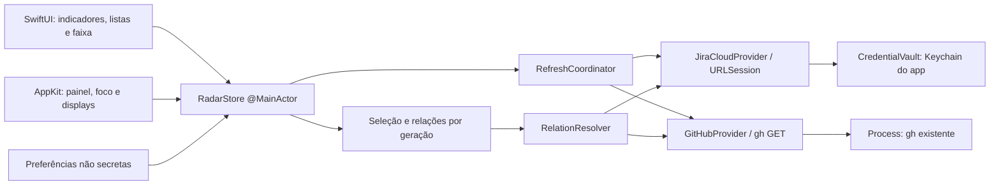

# Radar — design da V1 pessoal

**Status**: implementação local autorizada; defaults adotados qualificáveis em AD-010. **Spec**: [spec.md](spec.md).  
**Decisões lidas**: AD-001 a AD-016 de [STATE](../../STATE.md).

As descrições de diretório inexistente e caminhos futuros abaixo registram a baseline histórica do planejamento. A árvore implementada, tarefas e gates atuais estão em [STATE](../../STATE.md), [tasks](tasks.md) e no [manifesto](../../../docs/evidence/manifest.md); não são resultados inferidos deste design.

## Abordagens consideradas

| Abordagem, mesmo escopo | Benefício | Custo | Proposta |
|---|---|---|---|
| SwiftUI para conteúdo + AppKit para NSPanel em target Xcode | Composição declarativa, ponte pequena e bundle/callbacks/assinatura centralizados. | Exige integrar foco e coordenadas entre as duas tecnologias. | Recomendada. |
| AppKit para toda a UI, no mesmo target Xcode | Controle uniforme de janela/eventos. | Mais código de composição e manutenção visual. | Viável, sem ganho demonstrado para este app. |
| Mesmo conteúdo SwiftUI/AppKit em SwiftPM com montagem manual de .app | Projeto inicial enxuto. | Empacotamento, recursos, metadados e assinatura passam a ser fluxo próprio. | Viável; adiar até existir benefício real. |

T01 migrou o plano; scaffold começa em T02. A stack sugerida é Swift com concorrência estrita conforme toolchain disponível, Foundation/URLSession, SwiftUI, AppKit e Security/Keychain. Não há dependência de terceiros necessária demonstrada. As regras de tipagem segura aplicam-se à stack nativa; TypeScript só será considerado se houver uma futura feature de serviço.

## Situação observada e reaproveitamento

O diretório atual contém estudos, imagens e documentação; não há app Swift, manifesto, Xcode project ou repositório Git. Não existem convenções de código para copiar. Reutilizar a identidade V3, critérios, artefatos REA e fluxos — não copiar código de concorrentes.

Destino sugerido para futura execução: um repositório dedicado escolhido pelo usuário, por exemplo Developer/Radar. Nenhum diretório de implementação foi criado. Ao migrar, copiar .specs e referências para docs/assets, preservar regras locais e requalificar comandos.

## Visão de componentes

O app não usa Codex, LLM ou REA como dependência de runtime. Essas ferramentas apoiam desenvolvimento e investigação. Não é necessário SDK de agentes ou chave OpenAI para o produto proposto.

## Responsabilidades e locais sugeridos

Caminhos abaixo são propostos dentro do futuro repositório, não arquivos criados.

| Componente | Responsabilidade | Local |
|---|---|---|
| ScreenGeometryResolver | Tela/recorte/área utilizável e bounds. | Radar/Platform/ScreenGeometryResolver.swift |
| NotchPanelController | Uma instância NSPanel hospedando conteúdo, frame e hit area. | Radar/Platform/NotchPanelController.swift |
| PanelInteractionController | Foco, cliques e fechamento por causa. | Radar/Platform/PanelInteractionController.swift |
| PresentationMotionPolicy | Preferência de movimento e parâmetros de transição. | Radar/Platform/PresentationMotionPolicy.swift |
| RadarTheme | Tokens nativos mínimos da identidade V3. | Radar/Presentation/RadarTheme.swift |
| RemoteIdentity e modelos | Identidade, domínio de card e PR, snapshots e contagem. | Radar/Domain/ |
| RadarStore e SelectionStore | Estado observável e seleção por identidade. | Radar/Application/ |
| RefreshScheduler | Orçamento e próxima elegibilidade, sem acessar segredos. | Radar/Application/RefreshScheduler.swift |
| CompactNotchView | Indicadores, rótulos e acionamento. | Radar/Presentation/Notch/ |
| JiraListView / GitHubListView | Listas e ações de seleção, sem lógica de rede na composição visual. | Radar/Presentation/Jira/ e GitHub/ |
| DetailsStripView | Contexto card/PR, status separados e relações. | Radar/Presentation/Details/ |
| ConnectionsSettingsView | Entrada segura Jira e configuração do gh. | Radar/Presentation/Connections/ |
| JiraCloudConnection / SearchClient | Identidade, auth pessoal e enhanced search paginado. | Radar/Integrations/JiraCloud/ |
| ExecutableResolver / CLITransport | Resolver gh e executar contrato estreito. | Radar/Integrations/GitHubCLI/ |
| GitHubPersonalPRProvider / DetailProvider | Consultas pessoais, união, CI e revisões. | Radar/Integrations/GitHub/ |
| JiraKeyReference / RelationResolver | Referências explícitas e relações com proveniência. | Radar/Application/Relations/ |
| PreferencesStore / DataLifecycleController | Preferências e invalidação de memória. | Radar/Persistence/ e Application/ |
| AppComposition / NavigationCoordinator | Dependências e destinos HTTPS. | Radar/App/ e Platform/ |

Separar subcomponentes e tipos quando melhorarem revisão e leitura; evitar pacotes internos, camada de DI externa, abstração de banco, interfaces genéricas sem necessidade e reexportações.

## Contratos acordados entre agentes

Estes contratos foram discutidos diretamente por radar_native_plan e radar_providers_plan, com convergência relatada ao orquestrador. São contratos de design a implementar, não APIs existentes.

| Contrato | Campos/conceito | Invariante |
|---|---|---|
| JiraIdentity | site/cloudID + issueID; key separada | Mesmo texto de key em sites diferentes não une itens. |
| PullRequestIdentity | host + repositoryID estável + número; fallback normalizado owner/repo | Dois repos com #181 permanecem distintos; alias de fallback e ID estável são reconciliados antes de publicar, sem duplicar ou transferir seleção. |
| ConnectionID | Proveniência da conexão e permissões | Não é a identidade usada para deduplicar objeto remoto. |
| WorkContextID | Escopo profissional ativo | Um contexto não recebe resposta de outro. |
| SourceSnapshot<Item> | Itens, escopo, completude, total, lastSuccessfulAt | Snapshot antigo pode coexistir com refresh e erro. |
| Count | exact(n), partial(lowerBound), unknown | Exato exige união completa deduplicada; parcial nunca vira zero exato. |
| SourceStatus | Conexão, refreshing, problem, freshness em dimensões próprias | Uma enum loading/stale/error exclusiva é insuficiente. |
| SelectionKey | contextID + canonicalItemID | Nunca selecionar por índice da lista. |
| RelationQuery | SelectionKey + generation + orçamento | Aplicar somente se geração/identidade ainda forem atuais. |
| Relation | Card, PR, origem, escopo, proveniência e completude | Referência textual não se apresenta como confirmação do Jira. |
| PRDetails | SHA atual, lifecycle, CI e revisão separados | Histórico de aprovação não certifica merge atual. |

Credenciais não entram nesses modelos, em mensagens ou evidências. O único acesso Jira ao segredo é o fluxo autorizado do próprio app por CredentialVault; agentes não consultam Keychain.

Resultados de busca GitHub podem exigir uma leitura limitada do repo para obter repositoryID. Manter resolução/aliases apenas em memória por contexto; se não for possível resolver com segurança, conservar identidade de fallback coerente e marcar a limitação. Enriquecimento não troca a identidade publicada sem reconciliar a seleção e a união. Essa regra pertence a T08/T27, não à view.

Com painel aberto, lista apresentada e seu total pertencem à mesma revisão de snapshot. Um snapshot novo é preparado com indicador “Atualização disponível”; aplicar por ação explícita ou ao fechar/reabrir. Não combinar total novo com linhas antigas sem explicar divergência. Detalhe do item pode atualizar SHA/fase independentemente; se deixar de pertencer à lista, marcar esse contexto e não reinterpretá-lo como item de outro índice.

## Interface e foco

SwiftUI controla composição e estado visual; AppKit controla a superfície e eventos de janela. Uma ponte pequena por NSHostingView evita duas fontes de seleção. A Apple documenta [NSHostingView](https://developer.apple.com/documentation/swiftui/nshostingview) e [nonactivatingPanel](https://developer.apple.com/documentation/appkit/nswindow/stylemask-swift.struct/nonactivatingpanel).

- Fechado: não recebe teclado nem ativa o app; cliques só na área real visível.
- Clique explícito: abre, permite key focus e navegação local.
- Refresh: não ativa nem muda foco.
- Esc em detalhes: mantém painel e devolve foco à linha.
- Esc na visão geral: fecha e pode devolver interação ao app anterior.
- Clique fora: preserva o destino clicado.
- Link externo: preserva navegador; não reativa IDE depois.
- Ao fechar: remover observação transitória de cliques. Não adicionar captura global de teclas, leitura de digitação, câmera ou Screen Recording.

A geometria usa tela real e [safeAreaInsets](https://developer.apple.com/documentation/appkit/nsscreen/safeareainsets). Em T04, antes de integrar contas, o painel desconectado passa por uma prova mínima nos modos locais disponíveis de Spaces/fullscreen/Stage Manager, registrando política ou fallback por modo. T38 liga mudanças dinâmicas de display e amplia a matriz no app integrado. Modos/hardware indisponíveis permanecem não qualificados. Não copiar flags de um concorrente e chamar isso de compatibilidade macOS 27.

## Integrações pessoais

### Jira Cloud

Proposta pessoal condicionada à política da conta: token com escopos mínimos, informado na interface segura e guardado no Keychain do Radar. Nenhum token no chat, argumentos, preferência, screenshot ou documento.

O adapter deve qualificar o tipo do token, site e cloudID e escolher o gateway/base URL documentado para esse tipo; tokens com escopos não são presumidos equivalentes a tokens legados. Confirmar permissões dos endpoints de identidade e busca na tarefa de conexão.

Usar enhanced search /rest/api/3/search/jql e nextPageToken, com JQL assignee = currentUser() AND statusCategory != Done e escopo explícito. Evitar o search legado em remoção. [Busca Jira Cloud](https://developer.atlassian.com/cloud/jira/platform/rest/v3/api-group-issue-search/).

O OAuth 3LO documenta client_secret na troca e no refresh; não planejar segredo dentro de .app. Distribuição futura exige reavaliar auth, política Atlassian e serviço confidencial. Isso fica fora da V1. [3LO](https://developer.atlassian.com/cloud/jira/platform/oauth-2-3lo-apps/), [API tokens](https://support.atlassian.com/atlassian-account/docs/manage-api-tokens-for-your-atlassian-account/).

### GitHub.com pelo gh

Reutilizar gh existente, deixando o próprio CLI consumir sua autenticação. O app não executa gh auth token/status/login/refresh/switch, não lê config/auth e não extrai credenciais. A documentação permite fallback de armazenamento do CLI em arquivo; portanto não afirmar que a auth existente está no Keychain.

Contrato GitHubTransportPolicy:

- Process com executableURL absoluta e vetor de argumentos; nenhum shell/profile.
- gh api, --hostname github.com, --method GET explícito e endpoints REST construídos por código.
- Sem URL arbitrária, -F/@arquivo, --input, placeholders de repo, extensões, templates, --verbose, --cache ou GraphQL na V1.
- Ambiente mínimo de variáveis não secretas permitidas; não importar valores de token do terminal, debug HTTP ou profiles. gh usa a configuração padrão/pessoal por conta própria, sem o Radar abrir seus arquivos. Personalização corporativa fora desse ambiente exige qualificação própria.
- GH_PROMPT_DISABLED=1, saída sem pager e debug desativado; não iniciar prompts interativos dentro do app.
- Pipes em memória drenados concorrentemente; timeout, cancelamento, limite de saída e um resultado terminal. Não bloquear MainActor esperando o processo.
- Se usar --include para status/limites, reter apenas headers permitidos de controle e JSON selecionado; não registrar stdout/stderr brutos.
- Não instalar/atualizar gh, Homebrew, Rosetta ou alterar quarantine automaticamente.
- Qualificar app iniciado pelo Finder. O PATH/auth de um terminal não prova disponibilidade no app.

Manual [gh api](https://cli.github.com/manual/gh_api): flags de parâmetros podem mudar método padrão, por isso GET explícito. [Ambiente](https://cli.github.com/manual/gh_help_environment) e [códigos de saída](https://cli.github.com/manual/gh_help_exit-codes): code 4 informa necessidade de auth; code 1 não prova sessão expirada.

Buscar autoria, atribuição e revisão e unir por identidade. O [limite de busca](https://docs.github.com/en/rest/search/search) e incomplete_results continuam aplicáveis por trás do CLI. Checks/statuses usam SHA atual; não chamar ausência ou permissão negada de sucesso.

### Sandbox e assinatura

A Apple documenta que [Process](https://developer.apple.com/documentation/foundation/process) herda sandbox. Proposta para V1 pessoal: configuração local sem App Sandbox, com assinatura/Hardened Runtime, sujeita à aceitação do plano e à prova pelo Finder. Não significa root, permissões totais do sistema ou distribuição aprovada.

App Store exige outro desenho de distribuição. [Preparação para distribuir](https://developer.apple.com/documentation/xcode/preparing-your-app-for-distribution) e [Hardened Runtime](https://developer.apple.com/documentation/security/hardened-runtime). Não foi alterado nenhum entitlement ou configuração.

## Relações, limites e ciclo dos dados

A relação parte de chave explícita em título/branch e contexto de sites/repos autorizados. Não usar semelhança de títulos, busca ilimitada na organização ou endpoint privado de Development. A [API pública Development Information](https://developer.atlassian.com/cloud/jira/software/rest/api-group-development-information/) não estabelece uma leitura universal do painel para este desktop.

Normalizar referência de chave com limites de token: eng-241/login pode se referir a ENG-241, mas ENG-2410 não se refere a ENG-241. Validar contra site/projeto do contexto. Um PR pode ligar vários cards e o inverso.

Defaults propostos A09–A11:
- Listas a cada 60 s; detalhe visível a cada 15 s, respeitando limites e sem consultas de detalhe em background sem seleção.
- Timeout 15 s por request/processo; teto 5 MiB; páginas até 10/consulta.
- Relações sob demanda: orçamento de 20 chamadas e 30 s no total; ao esgotar, parcial.
- Sleep pausa trabalho; wake pode coalescer uma atualização.
- Retry usa Retry-After/reset quando fornecido; nenhum loop de tentativa imediata.
- Dados de trabalho em memória; preferências não secretas e mapeamentos de repo persistem separadamente. Nenhum cache gh em disco ou SQLite.
- Origem autenticada é qualificada por identidade, sem consultar credenciais. Se usuário externo trocar conta do gh, invalidar estado e exigir requalificação do contexto.
- Account switch/novo contexto incrementa geração e limpa seleção; cancelar é acompanhado de guarda de geração.

## Estados visuais e relações executáveis

| Dimensão | Vocabulário inicial | Regra |
|---|---|---|
| Fase do PR | Rascunho, aberto, mesclado, fechado | A lista pessoal consulta abertos; um item selecionado pode mudar de fase enquanto está visível. |
| CI | Em execução/pendente, passou, falhou, cancelado, sem checks, indisponível | Agregar somente contexto do SHA atual; neutral/skipped não são falha nem autorização para pintar tudo de verde. |
| Revisão | Sua revisão, aguardando revisão, alterações solicitadas, aprovação registrada, indisponível | Responsabilidade é diferente de decisão; aprovação registrada não certifica cumprimento de branch protection. |
| Repositório | owner/repo + símbolo/selo neutro, categoria opcional explícita | WEB/API/infra são mapeamentos escolhidos; não classificar só pelo nome. |
| Consulta | Consultando, completo vazio, parcial, problema com/sem snapshot | Freshness e refresh podem coexistir com conteúdo e erro. |

Precedência do contador: unknown → —; parcial sem item confirmado → …; parcial com itens → n+ até 99, depois 99+; completo → total exato até 99, depois 99+. O rótulo acessível distingue “pelo menos n” de total exato. Não usar “0+” como ausência confirmada.

Estratégia de relações da V1: reusar PRs conhecidos e listar, sob demanda, PRs abertos dos repositórios explicitamente autorizados por GET /repos/{owner}/{repo}/pulls. Examinar título e head.ref com limites de token, sem inventar um qualificador de busca GitHub por branch. Para o sentido PR→card, buscar o card por chave no site/projeto do contexto e conservar issueID. Repos não percorridos/páginas cortadas mantêm completude parcial. A faixa declara o escopo “PRs abertos nos repositórios selecionados”; PRs encerrados fora do snapshot ficam para evolução, sem promessa de histórico exaustivo.

Allowlist inicial de trabalho, validada por código: GitHub /user, /search/issues e recursos estritos do repo/PR/commit/checks/reviews; Jira endpoints qualificados de identidade, enhanced search e leitura de issue. Somente GET, segmentos codificados/validados e parâmetros permitidos. O token Jira vai apenas ao gateway/site documentado para seu tipo; links abrem o site Jira e github.com. Nenhuma URL recebida em título/payload ganha autorização de execução.

A composição mínima de produção é ligada à medida que cada provider é criado, para permitir seu gate real sem mocks; T36 fecha a composição integrada.

### Publicação de detalhes e agregação de status

PRDetails carrega um token de versão próprio: WorkContextID + identidade do PR + selectionGeneration + detailGeneration + headSHA observado + observedAt. Iniciar outro refresh de detalhe incrementa detailGeneration mesmo sem mudar de seleção. Depois de ler o PR, checks/statuses são consultados pelo SHA capturado. Se um novo head for observado, a versão anterior é invalidada; uma resposta antiga nunca preenche o CI da nova versão. O app informa o SHA/horário observado: não afirma conhecer um push ainda não observado pelo servidor/cliente.

Política C1 de CI, implementada em T10/T28:

1. Consumir checks do SHA observado com o filtro documentado de execuções mais recentes e statuses mais recentes por contexto; seguir paginação até orçamento. Não mesclar reruns antigos com o conjunto atual. Se o provider não oferecer uma ordenação inequívoca, preservar “indisponível/parcial” em vez de escolher arbitrariamente um ID.
2. Conservar cada sinal e sua origem. Failure/error/timed_out geram “Falha observada”; action_required gera “Requer ação”. Essas condições têm precedência visual sobre pendência, sem apagar sinais conflitantes da lista de detalhes.
3. Sem falha/ação requerida: queued/pending/in_progress/waiting geram “Em andamento”; depois cancelamento gera “Cancelado”; conclusão desconhecida/incompleta gera “Indisponível/parcial”.
4. “Passou” só aparece com conjunto completo, não vazio, e todos os sinais observados concluídos em success. Não certifica checks obrigatórios nem merge.
5. Mistura de success com neutral/skipped usa texto neutro “Resultados mistos · conclusões neutras/ignoradas”; apenas neutral/skipped usa “Conclusões neutras ou ignoradas”; conjunto completo vazio usa “Sem checks”. Neutral pode ser conclusão de um check executado; skipped tem significado próprio. Não pintar esses casos como aprovação de CI.

Política C1 de revisão, qualificada pelo refinamento C1.3 (AD-015), implementada em T10/T28:

- Responsabilidade solicitada é uma informação própria: usuário direto, equipe ou sem solicitação conhecida. Sua revisão pode coexistir com decisões já registradas. Não inferir participação na equipe quando não houver essa capacidade.
- As decisões são registros, não avaliação das regras do repo. Primeiro restringir as decisões formais ao SHA atual; dentro desse conjunto, considerar a última decisão formal submetida por autor (identidade estável), incluindo dismissed para suprimir a decisão anterior desse mesmo SHA. Uma decisão de outro SHA não suprime a decisão registrada no SHA atual. COMMENTED/PENDING não são aprovação; DISMISSED não restaura decisão anterior.
- Se houver CHANGES_REQUESTED atual, mostrar “Alterações solicitadas (n)”; senão, APPROVED atual gera “Aprovações registradas (n)”. Mesmo nesse caso, não usar “Pronto para merge” ou afirmar quorum atendido. Se coexistirem aprovações e alterações solicitadas, conservar as duas contagens nos detalhes.
- Sem decisão formal atual, exibir “Aguardando revisão” quando houver solicitação conhecida, ou “Sem decisão no commit atual”. Registros de outro SHA aparecem como “Revisões em commit anterior”, sem afirmar que foram invalidados pela política do repo. A contagem histórica inclui todos os registros únicos submetidos com SHA conhecido diferente do atual, inclusive COMMENTED; registros PENDING sem submissão não entram nessa contagem.
- Submissões são ordenadas por submitted_at; ambiguidade/tie, resposta parcial ou permissão insuficiente é sinalizada e impede resumo conclusivo. O resumo exige cobertura completa das decisões e das solicitações de revisão; as contagens e solicitações já observadas continuam preservadas em campos separados, com sua cobertura explícita. Nunca inventar desempate sem base documentada.

O gate de T28 revisa explicitamente: mesmo PR com novo SHA e resposta antiga; rerun pendente após falha antiga; success+skipped; conjunto vazio vs inacessível; aprovação atual junto de revisão solicitada; aprovação antiga; COMMENTED e DISMISSED. São revisões de invariantes sem criar testes/mocks; observações reais complementam apenas as combinações existentes.

### Fronteira da identidade autenticada no gh

Cada lote de leitura GitHub (snapshot pessoal, enriquecimento ou relações) é serializado pelo transporte do Radar e delimitado por GET /user no início e imediatamente antes da publicação. Essas leituras contam no orçamento/limite, reservando capacidade para a qualificação final. O usuário esperado é a identidade estável qualificada do contexto, não apenas o login de apresentação.

Se o usuário final divergir do inicial/esperado, descartar o lote inteiro, incrementar geração, limpar dados/seleção GitHub incompatíveis e pedir requalificação. Se a verificação final não concluir, não publicar o lote novo; conservar somente o snapshot anterior identificado como desatualizado. Workers nunca executam gh auth switch para demonstrar isso.

A troca externa só pode ser detectada nas fronteiras de consulta; não há notificação garantida da configuração do gh. Uma troca de A→B→A entre subprocessos pode escapar dessa verificação, pois o gh não fornece neste desenho uma sessão de auth fixada por lote. Essa limitação residual é explícita da V1 pessoal: uma identidade gh ativa durante a sincronização; após troca externa, reconectar/requalificar no Radar. Não prometer isolamento transacional entre várias contas externas. Se esse isolamento for necessário, interromper a adoção desse adapter e abrir a especificação de GitHub App/auth próprio.

Essa fronteira não lê arquivos de auth, extrai token ou altera a conta externa. O escopo de repos autorizados continua obrigatório. T27/T35 implementam detecção/invalidação; T26 não expõe execução de auth.

## Refinamento publicado C1.1 — transporte gh

O orquestrador publicou antes da implementação: construir environment do zero; HOME por FileManager, PATH fixo; GH_PROMPT_DISABLED=1, GH_NO_UPDATE_NOTIFIER=1, GH_NO_EXTENSION_UPDATE_NOTIFIER=1, GH_TELEMETRY=false, GH_PAGER=cat, NO_COLOR=1. Não herdar GH_DEBUG/DEBUG/tokens/GH_CONFIG_DIR/GH_HOST/GH_REPO. Process e pipes fora MainActor, término único. Finder é qualificado em T26. A assinatura local ad-hoc pode exigir novo consentimento de Keychain após rebuild, observado somente pelo usuário no fluxo do app. Contratos de domínio C1 permanecem íntegros.

## Refinamento publicado C1.2 — versões e capacidades dos providers

GitHub envia `X-GitHub-Api-Version: 2026-03-10` e `Accept: application/vnd.github+json`. DTOs mínimos usam assignees[] e head.sha, sem assignee singular, merge_commit_sha ou metadados de repo removidos. Fonte: [breaking changes 2026-03-10](https://docs.github.com/en/rest/about-the-rest-api/breaking-changes#version-2026-03-10).

Jira exige tipo de token explícito: scoped usa Basic email:token em api.atlassian.com/ex/jira/{cloudId}; legado usa o site conforme documentação. Enhanced GET search/jql solicita summary,status,project,assignee,updated explicitamente, segue nextPageToken/isLast e detecta token repetido, contradição e warnings de truncamento como parcial. /myself e search têm capacidades distintas; não ampliar escopos automaticamente. Fontes: [token/gateway](https://support.atlassian.com/atlassian-account/docs/manage-api-tokens-for-your-atlassian-account/), [myself](https://developer.atlassian.com/cloud/jira/platform/rest/v3/api-group-myself/#api-rest-api-3-myself-get), [enhanced search](https://developer.atlassian.com/cloud/jira/platform/rest/v3/api-group-issue-search/#api-rest-api-3-search-jql-get), [schema oficial](https://dac-static.atlassian.com/cloud/jira/platform/swagger-v3.v3.json).

## Refinamento publicado C1.4 — responsabilidade e cobertura GitHub

`review-requested:LOGIN` inclui solicitações diretas e equipes das quais o usuário participa. O resultado da busca recebe `reviewRequestedUnclassified`; somente a presença da identidade estável autenticada em `requested_reviewers.users` qualifica `directlyRequestedReviewer`, e associação a equipe exige evidência suficiente para `confirmedTeamReviewer`. Preservar a busca ampla aprovada; não substituí-la silenciosamente pela consulta restrita de solicitações diretas. Fonte: [qualificadores de revisão](https://docs.github.com/en/search-github/searching-on-github/searching-issues-and-pull-requests#search-by-pull-request-review-status-and-reviewer).

Para statuses, consultar `/commits/{sha}/statuses`, preservar a ordem inversamente cronológica documentada e conservar a primeira ocorrência de cada `context`, comparado sem diferenciar maiúsculas/minúsculas. Não ordenar pelo ID nem usar o estado agregado de `/status` para o resumo Radar. Fonte: [commit statuses](https://docs.github.com/en/rest/commits/statuses?apiVersion=2026-03-10#list-commit-statuses-for-a-reference).

`/commits/{sha}/check-runs?filter=latest` considera somente as 1.000 suites mais recentes. O `total_count` desse endpoint conta runs e não detecta o teto de suites. Após a paginação de runs, consultar `/commits/{sha}/check-suites?per_page=1&page=1`, sem filtros, para o mesmo SHA e dentro do mesmo orçamento. Mais de 1.000 suites, total ausente/incoerente ou falha nessa qualificação mantém a cobertura de checks parcial. Total até 1.000 afasta somente esse teto na observação; runs válidos e paginação completa continuam necessários. Não inventar redução entre suites nem afirmar estabilidade transacional entre essas leituras. Fontes: [check runs](https://docs.github.com/en/rest/checks/runs?apiVersion=2026-03-10#list-check-runs-for-a-git-reference), [check suites](https://docs.github.com/en/rest/checks/suites?apiVersion=2026-03-10#list-check-suites-for-a-git-reference).

## Riscos e mitigação

| Risco/concern | Local | Impacto | Mitigação/tarefa |
|---|---|---|---|
| Nenhuma toolchain/projeto verificados | Novo projeto | Build/config propostos podem não existir. | T01 qualifica; comandos só são fixados depois. |
| Sobreposição e teclado no notch | NSPanel novo | Foco ou cliques incorretos. | T03–T05 e T38; prova cedo sem contas. |
| gh no Finder/sandbox/arquitetura | Process novo | CLI não disponível fora do terminal. | T25–T26/T41; sem instalação automática. |
| Troca externa da conta gh durante lote | Auth administrada pelo CLI | Pode haver troca não observável A→B→A entre comandos. | GET /user nas fronteiras e descarte por divergência; limite pessoal explícito; T27/T35. |
| Método pessoal Jira proibido pela conta | Auth nova | Integração fica bloqueada. | T23 para e propõe alternativa; não embutir segredo. |
| Escopos do gh podem incluir escrita | Credencial externa ao app | Leitura do Radar não é token read-only. | Allowlist de GET; não elevar escopos; T26/T28. |
| Contagem incompleta e duplicação | Busca/união nova | Indicador incorreto. | R03/R11, T11/T27; completude explícita. |
| Referência textual falsa ou cross-site | Resolver novo | Associação incorreta. | T29–T31, origem e escopo visíveis. |
| Conteúdo antigo sob nova seleção | Concorrência nova | Informação de outro card. | Geração e SelectionKey, T13/T31. |
| Poluição de contexto/segredo | Agentes e auth | Vazamento de informação. | Context pack redigido e mensagens sem payloads/segredos. |
| Não há suíte automatizada por política | Projeto novo | Limites de garantia maiores. | Gates manuais/build, NOT-RUN honesto e verificador independente. |
| Distribuição inferida de build local | Empacotamento | Alegação indevida. | T41 e roadmap separado. |

Não existem file:line de código legado a apontar: não há código do app neste workspace. A localização acima é o componente proposto.

## Uso de REA nesta arquitetura

Evidência já obtida: DMG Boring Notch 2.7.3, hash 23786382548d33c59b309db558e513a92e3f95b63d611544dcddf5d196e46698, 229 nós, plist com LSUIElement=true. Hash do arquivo local foi reconferido nesta etapa.

IDs: ev_87ab2f621d937034d80dd44186534310a52992788fdab200aa25bfb95b3ed5a0 e ev_f09d8121104d261e8f1523bc944131a8d5a6e20d0b2ef083e7c3a522022aac5a.

Não reabrir/reanalisar o mesmo pacote sem pergunta nova. Para código fonte próprio completo, usar ferramentas de código normais. Para pergunta sobre pacote/runtime, declarar alvo, hipótese, efeito e evidência esperada; analisar apenas o necessário, preservar limites e fechar sessão. Execução de binário de terceiro, instalação de engines ou captura de dados privados não é autorizada por este plano.

## Preparação para distribuição

Manter a UI dependente do contrato GitHubProvider, não de Process. Uma feature futura poderá substituí-lo por GitHub App/device flow. Jira distribuído terá desenho de 3LO/serviço confidencial próprio. Enterprise, assinatura Developer ID/notarização, atualizador e instalação limpa exigem novas tarefas; não ficam prometidos pela V1 pessoal.

## Refinamento publicado C1.5 — cofre pessoal

Keychain clássico do bundle local ad-hoc, sem sincronização/grupo compartilhado, com service fixo e referência UUID própria. Não usar kSecAttrAccessible como garantia neste modo; a documentação macOS condiciona esse atributo a Data Protection/sync. Nenhum acesso no init/onAppear/refresh: leitura/gravação/remoção somente após intenção explícita na UI. Conexão ativa retém token apenas em memória privada do adapter. Remoção com falha invalida uso em memória, mas conserva referência para retry e informa pendência. Consentimento/negação e comportamento após rebuild dependem de validação humana; agentes nunca executam o cofre. Publicado antes dos consumidores T23/T35, discutido com integration_review e presentation_review.

## Refinamento publicado C1.6 — backoff por origem

C04, acordado entre root/state_audit e anunciado ao writer antes da correção: deadlines de rate limit pertencem a WorkSource e sobrevivem à vida de Entry. O scheduler mantém no máximo duas entradas de cooldown por processo, conservadoras mesmo ao trocar conta/contexto. remove/removeAll/reconfigure não apagam limite ainda vigente; somente expiração o remove. Resultado tardio de operação removida ainda amplia o deadline antes de descartar o slot. start verifica o limite como barreira final; extensão reagenda wakeups elegíveis da mesma origem. Operações já iniciadas antes de conhecer o limite não são encerradas só por esse novo aviso. Em cada origem, o maior Retry-After/reset observado prevalece; nenhuma troca de seleção/escopo serve para contornar espera.

A revisão de T13 identificou separadamente uma questão futura de autoridade de head: lastSuccessfulAt do snapshot é término do lote, não instante de leitura de head. Não usar esse valor para ordenar com PRDetailVersion.observedAt. A busca pessoal não inventa headSHA; a versão do detalhe continua vinculada à leitura explícita do PR. Qualquer enriquecimento futuro que leve head ao snapshot deve publicar regra explícita antes de invalidar/substituir a observação de detalhe. Nenhum defeito de fluxo integrado foi alegado antes de existir esse produtor.

## Refinamento publicado C1.7 — espera de indisponibilidade

Acordo root/providers_writer antes do consumidor: SourceProblem.serviceUnavailable(retryAfter: Date?) representa 503, inclusive sem header, e demais 5xx com Retry-After. O transporte preserva a espera em segundos ou HTTP-date; o scheduler a aplica por origem, com fallback60s quando ausente/inválida, e a UI distingue indisponibilidade de limite de requisições. X-RateLimit-Reset Jira aceita ISO8601 com ou sem frações de segundo. Não há retry interno imediato ou ampliação de escopo. Isto complementa C1.6; a implementação será C05 separada de C04 para manter revisão/commit atômicos. Fonte: [Atlassian rate limiting, response headers](https://developer.atlassian.com/cloud/jira/platform/rate-limiting/), consultada23/10/2026, documenta Retry-After também em respostas transitórias5xx.

## Refinamento publicado C1.8 — conteúdo parcial e problema de consulta

Acordo root/providers_writer/integration_review antes de T24: SourceSnapshot acrescenta observedProblems:[SourceProblem] com default vazio. allProblems agrega falhas de query na ordem PersonalWorkQuery e depois observedProblems; firstProblem deriva desse conjunto apenas para apresentação. isComplete exige todas queries completas e observedProblems vazio. O scheduler recebe todos os problemas, nunca somente firstProblem.

Depois de página validada, uma interrupção pode produzir itens observados com QueryCoverage.partial(interrupted) e o erro técnico sanitizado separado; zero observado nessa condição continua parcial, não vazio completo. Receber bytes não prova observação válida. Sem página/observação útil, terminar refresh com falha e preservar snapshot anterior. Cancelamento ou geração/contexto inválido não publica. A extensão não permite armazenar payload, mensagem remota ou segredo em SourceProblem e não dispensa as guardas de identidade/autenticação.
