# Radar — plano de tarefas

**Status**: Execute local autorizado por AD-009. T01/T02 concluídas; demais conforme registro por tarefa.  
**Referências**: [spec](spec.md), [design](design.md), [coordenação](coordination.md), [verificação](verification-plan.md), [STATE](../../STATE.md).

## Como executar este plano

Uma tarefa por vez, na ordem abaixo, com um commit atômico por entrega. O grafo é uma ordem total: cada tarefa depende da anterior; dependências de componentes anteriores são transitivas. Cada fase inteira forma um lote de sete tarefas para um worker, sem escritores de código concorrentes.

As seis fases são lotes de coordenação, não estimativas de dias. T01 qualifica o ambiente; não há previsão confiável de duração antes disso. Mudanças de escopo viram novas tarefas atômicas e atualização do grafo/matriz, sem esconder correções em um relatório de validação.

Caminhos são propostos no futuro repositório. Antes de editar, conferir a estrutura real, adaptar caminhos sem alterar contratos e declarar o escopo. A autorização local atual está em AD-009; o pacote original permanece referência histórica.

T02 cria um ponto mínimo de composição real. Cada tarefa de integração inclui a ligação mínima de sua ação à UI de produção já existente, necessária para seu gate real. T23 habilita conectar Jira; T24 a consulta Jira; T25–T27 a qualificação/consulta gh. Não criar executável de teste, seed de negócio ou mock para essa prova. T36 consolida a composição completa, sem refazer os componentes.

Antes de um commit: gate da tarefa, evidência sanitizada e revisão do diff. Registrar o hash depois do commit no handoff/manifesto do lote; não inventar um hash antes de existir. Código pode ser escrito pelo worker, mas interação sensível e entrada de token pertencem ao usuário diretamente no app.

## Exceção de execução autorizada — AD-013

O pedido atual autoriza continuar trabalho independente diante de impedimento de acesso/interação. Ordem de implementação e um escritor continuam; tarefa com gate obrigatório NOT-RUN permanece PARTIAL e não conclui lote/aceite. Só partes independentes podem ser preparadas, compiladas/revisadas e commitadas com limite explícito. O timeout CUA de T02 foi resolvido por evidência manual do usuário antes do commit; AD-013 permanece para futuros bloqueios.

## Fases e lotes

| Lote | Tarefas | Resultado |
|---|---|---|
| 1 — Base nativa | T01–T07 | Painel e foco comprovados sem contas. |
| 2 — Domínio e estado | T08–T14 | Identidades, snapshots, seleção e limites. |
| 3 — Apresentação Radar | T15–T21 | Identidade V3 e navegação, inicialmente desconectadas. |
| 4 — Integrações pessoais | T22–T28 | Jira Cloud e GitHub.com/gh com qualificação real. |
| 5 — Relações e recuperação | T29–T35 | Card ↔ PR, atualização e isolamento. |
| 6 — Integração e qualificação | T36–T42 | Fluxo real, acessibilidade, bundle pessoal e handoff. |

## Test Coverage Matrix

Esta matriz documenta **verificação prevista**, sem prometer cobertura automatizada. A regra explícita do usuário é: “Não criar testes, arquivos de teste ou mocks, a menos que o usuário peça explicitamente.” Ela prevalece sobre a exigência padrão da TLC por testes/sensor. AD-005 registra a adaptação.

| Camada | Requisitos | Automação nova | Verificação permitida | Quando |
|---|---|---|---|---|
| Painel/recorte/foco | R01/R02/R04/R18/R22 | Nenhuma | Build + interação no Mac e cenários de display qualificados | T02–T07/T38–T41 |
| Domínio/concorrência | R03/R07/R11/R14/R26 | Nenhuma | Build + revisão de invariantes + UAT real | T08–T14/T31–T35/T42 |
| UI/estados/acessibilidade | R05/R06/R13/R17/R20 | Nenhuma | Comparação V3 + teclado/VoiceOver/Reduzir Movimento | T15–T21/T40/T42 |
| Auth/providers/limites | R08–R12/R15/R16/R27/R28 | Nenhuma | Revisão das fronteiras + consultas reais autorizadas | T22–T33/T42 |
| Persistência/ciclo | R19/R26 | Nenhuma | Revisão de escrita própria + reinício/desconexão via UI | T22/T34–T36/T42 |
| Bundle e recursos | R21/R22 | Nenhuma | Build/Finder/assinatura observados + medição manual | T39–T41 |
| Coordenação/evidência | R23–R25 | Nenhuma | Conferência documental e verificador independente | T01/T39–T42 |

Unit/integration/E2E, arquivos de testes, mocks e sensor de mutação: **não criar; NOT-RUN por política**. Isso não equivale a PASS nem a cobertura automatizada. Cenário manual indisponível também permanece NOT-RUN; se obrigatório, bloqueia aceite até execução ou revisão explícita do escopo.

## Gate Check Commands

Não existe projeto Xcode neste workspace. Os comandos do app abaixo são **modelos para qualificar no futuro**, nunca registros de execução. Não adicionar lint/framework/runner apenas para preencher esta tabela.

| Gate | Procedimento/comando futuro | Resultado exigido |
|---|---|---|
| DOC | Conferir IDs, dependências, caminhos, decisões, evidências e diff dos documentos. | Nenhum órfão, decisão perdida ou alegação sem evidência. |
| BUILD em T01 | Identificar macOS, Xcode selecionado e SDK instalado por metadados públicos. | Registrar versões reais; não pressupor Xcode/SDK 27 disponível. |
| BUILD após T02 | Descobrir projeto/scheme reais com `xcodebuild -list -project <projeto-real>`; fixar em docs/readiness.md. | Target app sem targets de teste. |
| BUILD padrão | Modelo: `xcodebuild -project <projeto-real> -scheme <scheme-real> -configuration Debug -destination 'platform=macOS' -derivedDataPath <pasta-local-de-build> build`. | Exit code de build bem-sucedido e saída resumida sanitizada. Nenhum valor entre <> é executável antes de T02. |
| UI-base | Abrir o bundle pelo caminho completo e executar somente o procedimento disponível para a tarefa, na tabela de maturidade abaixo. | Evidência parcial da tarefa; não declarar o caso integrado Uxx completo antecipadamente. |
| UI-integrada | Com composição real disponível, executar os subcritérios pertinentes de U01/U02/U04/U05/U06/U17. | Comportamento observado no app, sem números de negócio artificiais. |
| LIVE-* | Casos U08–U16/U19/U20/U26–U28 com contas/escopos já autorizados, interação direta do usuário quando necessária. | Resultados sem secrets/payloads/identificadores internos nos documentos. |
| PERF | U22: 30 ciclos + repouso; ferramentas nativas disponíveis, sem leitura de logs. | Medidas observadas ou NOT-RUN; cumprir R22 antes de aceite. |
| UI-visual-a11y/UI-display | U05/U17/U18 com V3 e opções do sistema. | Hardware/modos suportados separados dos não exercitados. |
| RELEASE-local | Build da configuração local real; U21: Finder + metadados de assinatura/entitlements. | Configuração pessoal reproduzível; não inferir distribuição. |
| UAT | Um registro por critério em verification-plan.md (56 critérios). | Obrigatórios PASS com evidência; demais NOT-RUN explicitamente justificados. |

O executor pode capturar status de build e diagnósticos sanitizados diretamente do processo que iniciar; não deve abrir/copiar arquivos de log, arquivos de auth, bancos ou históricos proibidos. Relatórios de evidência são registros resumidos criados para este projeto, sem saída bruta. Erros que mostrem segredo são registrados somente como [REDACTED].

### Maturidade dos gates de UI e integração

| Tarefa | Procedimento obrigatório disponível nesse ponto | Aceite completo posterior |
|---|---|---|
| T02 | Iniciar bundle vazio/desconectado pelo caminho completo; menu/configurações e encerrar. Ainda não há painel. | R01 com painel em T04 e bundle em T41. |
| T04 | Abrir/recolher um único painel desconectado; conferir câmera/bounds/hit area/encerramento e prova mínima de Spaces/fullscreen/Stage Manager disponíveis, com política/fallback registrado. | Mudanças dinâmicas/matriz ampliada em T38; relações/teclado não são pré-requisito. |
| T05 | Conferir foco por clique, clique fora e Esc na camada geral existente. | Retorno da faixa/linha em T21/T36. |
| T07 | Interromper/reverter abertura; conferir hit area e modo reduzido nas transições já disponíveis. | Fluidez medida em T39. |
| T15 | Conferir indicadores desconectados e rótulos acessíveis, sem zero falso. Regras de parcial/99+ são revisadas, sem seed. | Contagens preenchidas em T24/T27/T36. |
| T19 | Abrir configurações, SecureField vazio e seleção de caminho; ações ainda sem provider ficam desabilitadas. | Conexão real em T23/T25–T27. |
| T20 | Abrir composição desconectada de duas colunas, preservar V3 e espaço da faixa. | Seleção preenchida e relações em T31/T36. |
| T21 | Navegar pelos controles reais disponíveis e Esc geral; revisar retorno por identidade nas listas. | Teclado completo sobre dados reais em T36/T40. |
| T23 | Ligar a ação Jira de produção à conexão e validar a identidade com entrada direta do usuário. | Lista em T24; relação em T30–T31. |
| T24 | Ligar consulta real à lista/store; conferir cards, escopo e resposta permitida. | Coalescência completa em T32. |
| T25 | Qualificar binário/versão pelo app e mensagem de ausência; ainda sem exigir consulta pessoal. | Consulta pelo Finder em T26–T27/T41. |
| T26 | Ligar validação GitHub a GET /user em produção e executar pelo app aberto no Finder. | Lista pessoal em T27; UI completa em T36. |
| T27–T35 | Exercitar o componente real recém-ligado conforme Done when, com revisão dos ramos condicionais sem dados artificiais. | Fluxo e aceite por critério em T36–T42. |

Não concluir U06/R06, por exemplo, só porque T20 compôs duas colunas vazias. A tarefa pode fechar seu gate de maturidade; o critério integrado permanece Pending até seu procedimento real.

## Grafo completo

```mermaid
flowchart LR
    subgraph P1["Lote 1: Base nativa"]
        T01 --> T02 --> T03 --> T04 --> T05 --> T06 --> T07
    end
    subgraph P2["Lote 2: Domínio e estado"]
        T08 --> T09 --> T10 --> T11 --> T12 --> C01 --> T13 --> T14
    end
    subgraph P3["Lote 3: Apresentação Radar"]
        T15 --> T16 --> T17 --> T18 --> T19 --> T20 --> T21
    end
    subgraph P4["Lote 4: Integrações pessoais"]
        T22 --> T23 --> T24 --> T25 --> T26 --> T27 --> T28
    end
    subgraph P5["Lote 5: Relações e recuperação"]
        T29 --> T30 --> T31 --> T32 --> T33 --> T34 --> T35
    end
    subgraph P6["Lote 6: Integração e qualificação"]
        T36 --> T37 --> T38 --> T39 --> T40 --> T41 --> T42
    end
    T07 --> T08
    T14 --> T15
    T21 --> T22
    T28 --> T29
    T35 --> T36
```

## Tarefas detalhadas

A coluna Requirement em cada tarefa cobre os requisitos relacionados; o aceite final continua por critério, não pelo simples fechamento da tarefa. Nos componentes iniciais de UI, dados preenchidos/status de rede são validados na integração real, sem simulação de negócio.

### T01 — Prontidão e gates do projeto

- **Status**: Complete — DOC PASS; evidência em docs/evidence/T01.md; hash real no manifesto após commit.
- **What**: Definir destino autorizado, ler regras/estrutura reais e registrar toolchain, modalidade Jira, presença/arquitetura do gh e comandos permitidos, sem consultar auth.
- **Where**: docs/readiness.md; .specs/STATE.md
- **Depends on**: Autorização explícita de Execute registrada em AD-009; nenhuma tarefa anterior.
- **Reuses**: Este plano e as referências V3.
- **Requirement**: R21, R23, R24, R25.
- **Tools**: Ferramentas de arquivo/build; documentação Apple e skill nativa específica somente quando necessária.
- **Done when**: Destino e política registrados; versões públicas e limites de acesso conhecidos; comandos de build ainda pendentes de T02 claramente marcados.
- **Tests**: Nenhum teste, arquivo de teste ou mock novo (AD-005). Build/revisão/UAT identificados separadamente.
- **Gate**: DOC; registrar ambiente, observado e evidência. NOT-RUN obrigatório impede concluir.
- **Commit**: `docs: register Radar execution readiness` — um commit por tarefa, após o gate.

### T02 — Target macOS e ciclo básico

- **Status**: Complete — BUILD/REVIEW PASS; UI-base MANUAL PASS confirmado pelo usuário. Evidência docs/evidence/T02.md.
- **What**: Criar um target Xcode do app pessoal, sem target de testes, com acesso ao menu/configurações e encerramento; registrar scheme real e gate de build.
- **Where**: Radar.xcodeproj; Radar/App/RadarApp.swift; Radar/Resources/
- **Depends on**: T01 (dependências anteriores transitivas).
- **Reuses**: T01 e frameworks nativos existentes.
- **Requirement**: R01, R21.
- **Tools**: Ferramentas de arquivo/build; documentação Apple e skill nativa específica somente quando necessária.
- **Done when**: Build do target real passa; app vazio/desconectado inicia e encerra; metadados, sandbox proposto e assinatura são explícitos.
- **Tests**: Nenhum teste, arquivo de teste ou mock novo (AD-005). Build/revisão/UAT identificados separadamente.
- **Gate**: BUILD + UI-base; registrar ambiente, observado e evidência. NOT-RUN obrigatório impede concluir.
- **Commit**: `feat: create Radar macOS app target` — um commit por tarefa, após o gate.

### T03 — Geometria do recorte

- **Status**: Complete — BUILD + REVIEW PASS; docs/evidence/T03.md.
- **What**: Resolver tela, safe areas e áreas auxiliares usando APIs públicas, com limites para telas sem notch.
- **Where**: Radar/Platform/ScreenGeometryResolver.swift
- **Depends on**: T02 (dependências anteriores transitivas).
- **Reuses**: Metadados públicos de NSScreen; target T02.
- **Requirement**: R02, R18.
- **Tools**: Ferramentas de arquivo/build; documentação Apple e skill nativa específica somente quando necessária.
- **Done when**: Geometria calculada respeita tela/recorte; valores não são dimensões fixas de um modelo de Mac.
- **Tests**: Nenhum teste, arquivo de teste ou mock novo (AD-005). Build/revisão/UAT identificados separadamente.
- **Gate**: BUILD + revisão de contrato; registrar ambiente, observado e evidência. NOT-RUN obrigatório impede concluir.
- **Commit**: `feat: resolve safe notch geometry` — um commit por tarefa, após o gate.

### T04 — Superfície do painel

- **Status**: PARTIAL — BUILD/REVIEW e abrir/recolher via CUA PASS; hit-through/encerramento confirmados pós-commit; modos ainda NOT-RUN; docs/evidence/T04.md.
- **What**: Criar uma única NSPanel com NSHostingView e área de clique limitada ao conteúdo visível, usando o conteúdo genuíno desconectado do app; qualificar política/fallback mínimo nos modos locais disponíveis de Spaces/fullscreen/Stage Manager antes de integrar contas.
- **Where**: Radar/Platform/NotchPanelController.swift
- **Depends on**: T03 (dependências anteriores transitivas).
- **Reuses**: T02 e T03.
- **Requirement**: R01, R02, R18, R22.
- **Tools**: Ferramentas de arquivo/build; documentação Apple e skill nativa específica somente quando necessária.
- **Done when**: Abrir/fechar não deixa superfície invisível; encerrar remove painel/observadores; geometria não depende de rede; prova mínima por modo disponível e fallback constam na evidência sem alegar suporte universal.
- **Tests**: Nenhum teste, arquivo de teste ou mock novo (AD-005). Build/revisão/UAT identificados separadamente.
- **Gate**: BUILD + UI-base; registrar ambiente, observado e evidência. NOT-RUN obrigatório impede concluir.
- **Commit**: `feat: host Radar notch panel` — um commit por tarefa, após o gate.

### T05 — Foco e causas de fechamento

- **Status**: Prepared — gate local BUILD/REVIEW + MANUAL humano PASS; dependência T04 PARTIAL, lote não concluído; complemento em docs/evidence/T05.md.
- **What**: Implementar foco após clique explícito, Esc e clique fora com causa de fechamento; fechar por link preservará o destino informado pelo coordenador.
- **Where**: Radar/Platform/PanelInteractionController.swift
- **Depends on**: T04 (dependências anteriores transitivas).
- **Reuses**: Painel T04; eventos locais de janela.
- **Requirement**: R01, R04, R17.
- **Tools**: Ferramentas de arquivo/build; documentação Apple e skill nativa específica somente quando necessária.
- **Done when**: Refresh não ativa app; clique fora preserva destino; teclado só é recebido com painel aberto e foco concedido.
- **Tests**: Nenhum teste, arquivo de teste ou mock novo (AD-005). Build/revisão/UAT identificados separadamente.
- **Gate**: BUILD + UI-base; registrar ambiente, observado e evidência. NOT-RUN obrigatório impede concluir.
- **Commit**: `feat: manage panel focus and dismissal` — um commit por tarefa, após o gate.

### T06 — Tokens da identidade V3

- **Status**: Prepared — gate local BUILD + revisão visual PASS; dependências T04/T05 PARTIAL, lote não concluído; docs/evidence/T06.md.
- **What**: Centralizar os tokens necessários de superfície, tipografia, espaçamento, seleção neutra e cores de origem/status.
- **Where**: Radar/Presentation/RadarTheme.swift
- **Depends on**: T05 (dependências anteriores transitivas).
- **Reuses**: Referência V3; padrões nativos.
- **Requirement**: R05.
- **Tools**: Ferramentas de arquivo/build; documentação Apple e skill nativa específica somente quando necessária.
- **Done when**: Tokens preservam V3, não introduzem barras laterais coloridas nem dependência visual externa.
- **Tests**: Nenhum teste, arquivo de teste ou mock novo (AD-005). Build/revisão/UAT identificados separadamente.
- **Gate**: BUILD + revisão visual; registrar ambiente, observado e evidência. NOT-RUN obrigatório impede concluir.
- **Commit**: `feat: define Radar visual tokens` — um commit por tarefa, após o gate.

### T07 — Política de transição

- **Status**: PARTIAL — BUILD/REVIEW/CUA e alternância rápida sem área invisível confirmada pelo usuário; Reduzir Movimento NOT-RUN; complemento em docs/evidence/T07.md.
- **What**: Implementar estados interrompíveis de abrir/fechar e Reduzir Movimento; calibrar depois sem aguardar rede.
- **Where**: Radar/Platform/PresentationMotionPolicy.swift
- **Depends on**: T06 (dependências anteriores transitivas).
- **Reuses**: T03–T06; preferências de acessibilidade do sistema.
- **Requirement**: R02, R04, R17, R22.
- **Tools**: Ferramentas de arquivo/build; documentação Apple e skill nativa específica somente quando necessária.
- **Done when**: Reversão de animação não mantém hit area antiga; modo reduzido funciona; tempos são parâmetros propostos, não medições.
- **Tests**: Nenhum teste, arquivo de teste ou mock novo (AD-005). Build/revisão/UAT identificados separadamente.
- **Gate**: BUILD + UI-base; registrar ambiente, observado e evidência. NOT-RUN obrigatório impede concluir.
- **Commit**: `feat: add interruptible notch transitions` — um commit por tarefa, após o gate.

### T08 — Identidade remota

- **Status**: Prepared — gate local BUILD + REVIEW independente PASS; dependências manuais parciais sob AD-013; docs/evidence/T08.md.
- **What**: Definir IDs de contexto, conexão, Jira e PR com hash/equality explícitos e tipagem segura.
- **Where**: Radar/Domain/RemoteIdentity.swift
- **Depends on**: T07 (dependências anteriores transitivas).
- **Reuses**: Contratos de design.md.
- **Requirement**: R11, R26.
- **Tools**: Ferramentas de arquivo/build e UI; referências canônicas; sem dependência nova por padrão.
- **Done when**: ConnectionID não duplica objeto; site+issueID e host+repoID+número preservam isolamento; fallback de repo é explícito.
- **Tests**: Nenhum teste, arquivo de teste ou mock novo (AD-005). Build/revisão/UAT identificados separadamente.
- **Gate**: BUILD + revisão de invariantes; registrar ambiente, observado e evidência. NOT-RUN obrigatório impede concluir.
- **Commit**: `feat: define remote work identities` — um commit por tarefa, após o gate.

### T09 — Modelo de card Jira

- **Status**: Prepared — gate local BUILD + REVIEW independente PASS; dependências manuais parciais sob AD-013; docs/evidence/T09.md.
- **What**: Representar card e status reais, chave de apresentação, identidade e link sem misturar segredo ou transporte.
- **Where**: Radar/Domain/JiraWorkItem.swift
- **Depends on**: T08 (dependências anteriores transitivas).
- **Reuses**: T08; campos mínimos da API documentada.
- **Requirement**: R10, R26.
- **Tools**: Ferramentas de arquivo/build e UI; referências canônicas; sem dependência nova por padrão.
- **Done when**: Status não é reduzido a uma lista fixa; chave não substitui identidade; modelo não contém credencial.
- **Tests**: Nenhum teste, arquivo de teste ou mock novo (AD-005). Build/revisão/UAT identificados separadamente.
- **Gate**: BUILD + revisão de invariantes; registrar ambiente, observado e evidência. NOT-RUN obrigatório impede concluir.
- **Commit**: `feat: model Jira work items` — um commit por tarefa, após o gate.

### T10 — Modelo de PR e estados

- **Status**: Prepared — gate local BUILD + REVIEW independente PASS; C1.3 aplicado após publicação AD-015; dependências manuais parciais sob AD-013; docs/evidence/T10.md.
- **What**: Representar PR, responsabilidades, repo e detalhes com lifecycle, CI e revisão independentes.
- **Where**: Radar/Domain/PullRequestItem.swift
- **Depends on**: T09 (dependências anteriores transitivas).
- **Reuses**: T08; contratos PRDetails.
- **Requirement**: R07, R11, R26.
- **Tools**: Ferramentas de arquivo/build e UI; referências canônicas; sem dependência nova por padrão.
- **Done when**: Unknown, pendente, sem checks e acesso negado não viram sucesso; revisão histórica não certifica regras atuais.
- **Tests**: Nenhum teste, arquivo de teste ou mock novo (AD-005). Build/revisão/UAT identificados separadamente.
- **Gate**: BUILD + revisão de invariantes; registrar ambiente, observado e evidência. NOT-RUN obrigatório impede concluir.
- **Commit**: `feat: model pull request state dimensions` — um commit por tarefa, após o gate.

### T11 — Snapshots e contagem

- **Status**: Prepared — gate local BUILD + REVIEW independente PASS; precondições dos consumidores registradas em docs/evidence/T11.md; dependências parciais sob AD-013.
- **What**: Definir snapshot imutável, completude, contagem e conexão/refresh/problema/freshness ortogonais.
- **Where**: Radar/Domain/SourceSnapshot.swift
- **Depends on**: T10 (dependências anteriores transitivas).
- **Reuses**: T08–T10.
- **Requirement**: R03, R11, R13, R27.
- **Tools**: Ferramentas de arquivo/build e UI; referências canônicas; sem dependência nova por padrão.
- **Done when**: Dados antigos podem coexistir com refresh e erro; count exact exige completude; classificação não converte erro em vazio.
- **Tests**: Nenhum teste, arquivo de teste ou mock novo (AD-005). Build/revisão/UAT identificados separadamente.
- **Gate**: BUILD + revisão de invariantes; registrar ambiente, observado e evidência. NOT-RUN obrigatório impede concluir.
- **Commit**: `feat: model source snapshots and completeness` — um commit por tarefa, após o gate.

### T12 — Estado principal

- **Status**: Prepared — gate local BUILD + REVIEW independente PASS; publicação/status/término guardados; dependências parciais sob AD-013; docs/evidence/T12.md.
- **What**: Criar estado observável no MainActor com snapshots por contexto, ordenação apresentada e invalidação.
- **Where**: Radar/Application/RadarStore.swift
- **Depends on**: T11 (dependências anteriores transitivas).
- **Reuses**: T08–T11.
- **Requirement**: R03, R13, R14, R19, R26.
- **Tools**: Ferramentas de arquivo/build e UI; referências canônicas; sem dependência nova por padrão.
- **Done when**: Publicação é atômica; seleção não altera totais; snapshot de outro contexto não é aplicado; novo ordenamento não move item sob ponteiro.
- **Tests**: Nenhum teste, arquivo de teste ou mock novo (AD-005). Build/revisão/UAT identificados separadamente.
- **Gate**: BUILD + revisão de invariantes; registrar ambiente, observado e evidência. NOT-RUN obrigatório impede concluir.
- **Commit**: `feat: manage contextual Radar state` — um commit por tarefa, após o gate.

### T13 — Seleção e geração

- **Status**: Prepared — BUILD + REVIEW do autor PASS; revisão independente interrompida por limite de uso dos subagentes; dependências parciais sob AD-013; docs/evidence/T13.md.
- **What**: Criar seleção por contexto+identidade, geração monotônica e restauração de foco por linha.
- **Where**: Radar/Application/SelectionStore.swift
- **Depends on**: C01 após T12 (dependências anteriores transitivas).
- **Reuses**: T08 e T12.
- **Requirement**: R04, R06, R14, R26.
- **Tools**: Ferramentas de arquivo/build e UI; referências canônicas; sem dependência nova por padrão.
- **Done when**: Trocar A→B invalida resposta de A; sair dos detalhes guarda referência de foco; nunca seleciona por índice.
- **Tests**: Nenhum teste, arquivo de teste ou mock novo (AD-005). Build/revisão/UAT identificados separadamente.
- **Gate**: BUILD + revisão de invariantes; registrar ambiente, observado e evidência. NOT-RUN obrigatório impede concluir.
- **Commit**: `feat: track identity based selection` — um commit por tarefa, após o gate.

### T14 — Agendamento limitado

- **Status**: Prepared — BUILD + REVIEW do autor PASS; revisão independente indisponível por limite de uso; ligação aos providers/sleep real posterior; docs/evidence/T14.md.
- **What**: Implementar elegibilidade por origem/escopo, coalescência, sleep/wake e backoff com cancelamento.
- **Where**: Radar/Application/RefreshScheduler.swift
- **Depends on**: T13 (dependências anteriores transitivas).
- **Reuses**: T11–T13; parâmetros A10–A11.
- **Requirement**: R14, R15, R22, R27.
- **Tools**: Ferramentas de arquivo/build e UI; referências canônicas; sem dependência nova por padrão.
- **Done when**: Uma consulta em voo por escopo; Retry-After/reset prevalece sobre timer; não existe loop imediato ou espera bloqueante no MainActor.
- **Tests**: Nenhum teste, arquivo de teste ou mock novo (AD-005). Build/revisão/UAT identificados separadamente.
- **Gate**: BUILD + revisão de invariantes; registrar ambiente, observado e evidência. NOT-RUN obrigatório impede concluir.
- **Commit**: `feat: schedule bounded source refresh` — um commit por tarefa, após o gate.

### T15 — Indicadores compactos

- **Status**: Prepared — BUILD + UI-base CUA/AX PASS desconectado; dados reais e VoiceOver posteriores; docs/evidence/T15.md.
- **What**: Criar a vista fechada com símbolos, totais e rótulos acessíveis por origem, incluindo unknown/parcial.
- **Where**: Radar/Presentation/Notch/CompactNotchView.swift
- **Depends on**: T14 (dependências anteriores transitivas).
- **Reuses**: T06, T07, T11 e T12.
- **Requirement**: R03, R05, R17.
- **Tools**: Ferramentas de arquivo/build e UI; referências canônicas; sem dependência nova por padrão.
- **Done when**: Área da câmera permanece livre; estado desconectado real é utilizável; regras de contagem estão ligadas ao contrato, sem números artificiais.
- **Tests**: Nenhum teste, arquivo de teste ou mock novo (AD-005). Build/revisão/UAT identificados separadamente.
- **Gate**: BUILD + UI-base; registrar ambiente, observado e evidência. NOT-RUN obrigatório impede concluir.
- **Commit**: `feat: render compact work indicators` — um commit por tarefa, após o gate.

### T16 — Lista Jira

- **Status**: Prepared — BUILD + revisão visual CUA desconectada PASS; linhas reais/seleção posteriores; docs/evidence/T16.md.
- **What**: Criar lista selecionável com status real, seleção cinza e ações locais de foco.
- **Where**: Radar/Presentation/Jira/JiraListView.swift
- **Depends on**: T15 (dependências anteriores transitivas).
- **Reuses**: T06, T09, T12 e T13.
- **Requirement**: R05, R06, R17.
- **Tools**: Ferramentas de arquivo/build e UI; referências canônicas; sem dependência nova por padrão.
- **Done when**: Estado desconectado/vazio é apresentável; composição preserva coluna esquerda e nenhum código de rede entra na view.
- **Tests**: Nenhum teste, arquivo de teste ou mock novo (AD-005). Build/revisão/UAT identificados separadamente.
- **Gate**: BUILD + revisão visual; registrar ambiente, observado e evidência. NOT-RUN obrigatório impede concluir.
- **Commit**: `feat: render Jira work list` — um commit por tarefa, após o gate.

### T17 — Lista GitHub

- **Status**: Pending.
- **What**: Criar lista de PRs com repo, responsabilidade e status separados sem barra colorida.
- **Where**: Radar/Presentation/GitHub/GitHubListView.swift
- **Depends on**: T16 (dependências anteriores transitivas).
- **Reuses**: T06, T10, T12 e T13.
- **Requirement**: R05, R06, R07, R17.
- **Tools**: Ferramentas de arquivo/build e UI; referências canônicas; sem dependência nova por padrão.
- **Done when**: Fase/CI/revisão não são um único badge; repo tem texto completo e símbolo/selo neutro; seleção conserva identidade.
- **Tests**: Nenhum teste, arquivo de teste ou mock novo (AD-005). Build/revisão/UAT identificados separadamente.
- **Gate**: BUILD + revisão visual; registrar ambiente, observado e evidência. NOT-RUN obrigatório impede concluir.
- **Commit**: `feat: render personal pull request list` — um commit por tarefa, após o gate.

### T18 — Faixa de detalhes

- **Status**: Pending.
- **What**: Criar uma faixa única de detalhes card/PR com estados consultando/vazio/falha/parcial e altura limitada; definir entradas de apresentação tipadas no próprio componente até a ligação ao resolver real, sem depender de tipo ainda não criado ou simular conteúdo de negócio.
- **Where**: Radar/Presentation/Details/DetailsStripView.swift
- **Depends on**: T17 (dependências anteriores transitivas).
- **Reuses**: T06, T10–T13; contrato Relation.
- **Requirement**: R05, R06, R07, R13, R17.
- **Tools**: Ferramentas de arquivo/build e UI; referências canônicas; sem dependência nova por padrão.
- **Done when**: Mesmo componente aceita ambos os sentidos; não ocupa o lugar das listas nem apresenta unknown como nenhum vínculo.
- **Tests**: Nenhum teste, arquivo de teste ou mock novo (AD-005). Build/revisão/UAT identificados separadamente.
- **Gate**: BUILD + revisão visual; registrar ambiente, observado e evidência. NOT-RUN obrigatório impede concluir.
- **Commit**: `feat: render contextual details strip` — um commit por tarefa, após o gate.

### T19 — Configurações de conexão

- **Status**: Pending.
- **What**: Criar UI de conexão por origem: entrada Jira segura e temporária, caminho do gh e validação; sem executar autenticação automaticamente.
- **Where**: Radar/Presentation/Connections/ConnectionsSettingsView.swift
- **Depends on**: T18 (dependências anteriores transitivas).
- **Reuses**: T06 e contratos de conexão; menu T02.
- **Requirement**: R08, R09, R20, R28.
- **Tools**: Ferramentas de arquivo/build e UI; referências canônicas; sem dependência nova por padrão.
- **Done when**: Entrada de segredo fica local à tela e é limpa; texto explica token Jira pessoal e gh existente; ações indisponíveis ficam claramente desabilitadas até serem ligadas.
- **Tests**: Nenhum teste, arquivo de teste ou mock novo (AD-005). Build/revisão/UAT identificados separadamente.
- **Gate**: BUILD + UI-base; registrar ambiente, observado e evidência. NOT-RUN obrigatório impede concluir.
- **Commit**: `feat: add personal connection settings` — um commit por tarefa, após o gate.

### T20 — Composição agrupada

- **Status**: Pending.
- **What**: Compor indicadores, duas colunas e faixa usando stores existentes e preservando tamanho/ordem de apresentação.
- **Where**: Radar/Presentation/RadarContentView.swift
- **Depends on**: T19 (dependências anteriores transitivas).
- **Reuses**: T15–T19; painel T04.
- **Requirement**: R04, R05, R06.
- **Tools**: Ferramentas de arquivo/build e UI; referências canônicas; sem dependência nova por padrão.
- **Done when**: Abrir mostra visão geral; selecionar solicita faixa sem alterar totais; dados não relacionados permanecem visíveis.
- **Tests**: Nenhum teste, arquivo de teste ou mock novo (AD-005). Build/revisão/UAT identificados separadamente.
- **Gate**: BUILD + UI-base; registrar ambiente, observado e evidência. NOT-RUN obrigatório impede concluir.
- **Commit**: `feat: compose grouped Radar surface` — um commit por tarefa, após o gate.

### T21 — Teclado e foco da apresentação

- **Status**: Pending.
- **What**: Ligar Tab/setas/Enter/Esc e retorno de foco às linhas estáveis; rotular estados para VoiceOver.
- **Where**: Radar/Presentation/RadarFocusCoordinator.swift
- **Depends on**: T20 (dependências anteriores transitivas).
- **Reuses**: T05, T13 e T20.
- **Requirement**: R04, R06, R17.
- **Tools**: Ferramentas de arquivo/build e UI; referências canônicas; sem dependência nova por padrão.
- **Done when**: Navegação local não instala atalho global; detalhes e visão geral fecham em duas etapas; rótulos de estado não dependem de cor.
- **Tests**: Nenhum teste, arquivo de teste ou mock novo (AD-005). Build/revisão/UAT identificados separadamente.
- **Gate**: BUILD + UI-base; registrar ambiente, observado e evidência. NOT-RUN obrigatório impede concluir.
- **Commit**: `feat: connect accessible panel navigation` — um commit por tarefa, após o gate.

### T22 — Cofre próprio Jira

- **Status**: Pending.
- **What**: Criar acesso limitado ao item Keychain do Radar com gravação, leitura no app e remoção própria; mapear erro sem valor secreto.
- **Where**: Radar/Persistence/CredentialVault.swift
- **Depends on**: T21 (dependências anteriores transitivas).
- **Reuses**: Security/Keychain; tela T19.
- **Requirement**: R08, R20.
- **Tools**: Ferramentas de arquivo/build; documentação oficial atual do provider via Context7 ou fonte primária; UI para entrada pessoal.
- **Done when**: Segredo não passa para stores/views gerais/evidências; remover conexão afeta somente item próprio; agentes não consultam Keychain.
- **Tests**: Nenhum teste, arquivo de teste ou mock novo (AD-005). Build/revisão/UAT identificados separadamente.
- **Gate**: BUILD + revisão de fronteira; registrar ambiente, observado e evidência. NOT-RUN obrigatório impede concluir.
- **Commit**: `feat: store Jira credential in app keychain` — um commit por tarefa, após o gate.

### T23 — Conexão Jira Cloud

- **Status**: Pending.
- **What**: Qualificar método permitido, token/gateway/site/cloudID e identidade; expor somente capacidade e erro sanitizado.
- **Where**: Radar/Integrations/JiraCloud/JiraCloudConnection.swift
- **Depends on**: T22 (dependências anteriores transitivas).
- **Reuses**: T19 e T22; documentação atual Jira.
- **Requirement**: R08, R16, R20, R27, R28.
- **Tools**: Ferramentas de arquivo/build; documentação oficial atual do provider via Context7 ou fonte primária; UI para entrada pessoal.
- **Done when**: Conexão real autorizada funciona com entrada direta pelo usuário; bloqueio por política não é contornado; 401 e 403 têm tratamento distinto.
- **Tests**: Nenhum teste, arquivo de teste ou mock novo (AD-005). Build/revisão/UAT identificados separadamente.
- **Gate**: BUILD + LIVE-Jira; registrar ambiente, observado e evidência. NOT-RUN obrigatório impede concluir.
- **Commit**: `feat: connect personal Jira Cloud account` — um commit por tarefa, após o gate.

### T24 — Busca de cards Jira

- **Status**: Pending.
- **What**: Buscar campos mínimos por enhanced search GET e seguir nextPageToken com orçamento, escopo de projetos e completude.
- **Where**: Radar/Integrations/JiraCloud/JiraCloudSearchClient.swift
- **Depends on**: T23 (dependências anteriores transitivas).
- **Reuses**: T09, T11, T14 e T23.
- **Requirement**: R03, R10, R15, R27, R28.
- **Tools**: Ferramentas de arquivo/build; documentação oficial atual do provider via Context7 ou fonte primária; UI para entrada pessoal.
- **Done when**: Cards atribuídos e não concluídos são retornados; término por limite/falha é parcial; endpoint legado não é usado.
- **Tests**: Nenhum teste, arquivo de teste ou mock novo (AD-005). Build/revisão/UAT identificados separadamente.
- **Gate**: BUILD + LIVE-Jira; registrar ambiente, observado e evidência. NOT-RUN obrigatório impede concluir.
- **Commit**: `feat: fetch paginated assigned Jira work` — um commit por tarefa, após o gate.

### T25 — Resolução do gh

- **Status**: Pending.
- **What**: Resolver caminho absoluto escolhido/padrões permitidos e qualificar binário, versão e execução fora do terminal; sem ler auth.
- **Where**: Radar/Integrations/GitHubCLI/GitHubExecutableResolver.swift
- **Depends on**: T24 (dependências anteriores transitivas).
- **Reuses**: Foundation/Process; T19 e metadados T01.
- **Requirement**: R09, R16, R20, R21.
- **Tools**: Ferramentas de arquivo/build; documentação oficial atual do provider via Context7 ou fonte primária; UI para entrada pessoal.
- **Done when**: gh ausente/incompatível ganha mensagem específica; caminho é validado sem instalar nada ou executar shell/profile.
- **Tests**: Nenhum teste, arquivo de teste ou mock novo (AD-005). Build/revisão/UAT identificados separadamente.
- **Gate**: BUILD + UI-gh; registrar ambiente, observado e evidência. NOT-RUN obrigatório impede concluir.
- **Commit**: `feat: qualify existing GitHub CLI executable` — um commit por tarefa, após o gate.

### T26 — Transporte REST pelo gh

- **Status**: Pending.
- **What**: Implementar allowlist GET, argumentos estruturados, ambiente não secreto, pipes assíncronos, timeout/cancel/output cap e classificação sanitizada.
- **Where**: Radar/Integrations/GitHubCLI/GitHubCLITransport.swift
- **Depends on**: T25 (dependências anteriores transitivas).
- **Reuses**: T11, T14 e T25; política do design.
- **Requirement**: R09, R14, R15, R16, R21, R22, R27, R28.
- **Tools**: Ferramentas de arquivo/build; documentação oficial atual do provider via Context7 ou fonte primária; UI para entrada pessoal.
- **Done when**: Chamada real permitida funciona pelo app; auth não é extraída; processo termina uma vez e não bloqueia UI nem grava stdout/stderr bruto.
- **Tests**: Nenhum teste, arquivo de teste ou mock novo (AD-005). Build/revisão/UAT identificados separadamente.
- **Gate**: BUILD + LIVE-GitHub; registrar ambiente, observado e evidência. NOT-RUN obrigatório impede concluir.
- **Commit**: `feat: add bounded read only gh transport` — um commit por tarefa, após o gate.

### T27 — PRs pessoais deduplicados

- **Status**: Pending.
- **What**: Qualificar identidade estável via GET /user antes e imediatamente ao publicar o lote; reunir três buscas paginadas de PRs abertos com papéis distintos e união por ID; divergência descarta o lote e falha na qualificação final impede publicar.
- **Where**: Radar/Integrations/GitHub/GitHubPersonalPRProvider.swift
- **Depends on**: T26 (dependências anteriores transitivas).
- **Reuses**: T08, T10, T11 e T26.
- **Requirement**: R03, R09, R11, R15, R26, R27, R28.
- **Tools**: Ferramentas de arquivo/build; documentação oficial atual do provider via Context7 ou fonte primária; UI para entrada pessoal.
- **Done when**: PR repetido conta uma vez; incomplete_results/1000/orçamento marcam parcial; mudança de usuário invalida geração; escopo real é visível.
- **Tests**: Nenhum teste, arquivo de teste ou mock novo (AD-005). Build/revisão/UAT identificados separadamente.
- **Gate**: BUILD + LIVE-GitHub; registrar ambiente, observado e evidência. NOT-RUN obrigatório impede concluir.
- **Commit**: `feat: fetch deduplicated personal pull requests` — um commit por tarefa, após o gate.

### T28 — Detalhes de CI e revisão

- **Status**: Pending.
- **What**: Enriquecer apenas seleção relevante com PR/commit/checks/statuses/reviews e SHA observado; aplicar o token headSHA+detailGeneration e as políticas determinísticas C1 de CI/revisão em design.md, mantendo dimensão desconhecida quando a capacidade faltar.
- **Where**: Radar/Integrations/GitHub/GitHubPRDetailEnricher.swift
- **Depends on**: T27 (dependências anteriores transitivas).
- **Reuses**: T10, T14, T26 e T27.
- **Requirement**: R07, R15, R27, R28.
- **Tools**: Ferramentas de arquivo/build; documentação oficial atual do provider via Context7 ou fonte primária; UI para entrada pessoal.
- **Done when**: CI e revisão reais aparecem separados; resposta de SHA/geração antigos é descartada; regras C1 para rerun/neutral/skipped/vazio/permissão/reviews/commented/dismissed são revisadas; nenhuma aprovação histórica vira certificação de branch protection ou prontidão para merge.
- **Tests**: Nenhum teste, arquivo de teste ou mock novo (AD-005). Build/revisão/UAT identificados separadamente.
- **Gate**: BUILD + LIVE-GitHub; registrar ambiente, observado e evidência. NOT-RUN obrigatório impede concluir.
- **Commit**: `feat: load current pull request checks and reviews` — um commit por tarefa, após o gate.

### T29 — Extração de referências Jira

- **Status**: Pending.
- **What**: Extrair chaves explícitas com limites de token de título/branch, normalizar e validar no contexto do site/projeto.
- **Where**: Radar/Application/Relations/JiraKeyReferenceExtractor.swift
- **Depends on**: T28 (dependências anteriores transitivas).
- **Reuses**: T08–T10; especificação R12/R16.
- **Requirement**: R12, R16.
- **Tools**: Ferramentas de arquivo/build; documentação oficial atual do provider via Context7 ou fonte primária; UI para entrada pessoal.
- **Done when**: ENG-241 e ENG-2410 não colidem; origem título/branch acompanha resultado; nome/texto nunca vira flag ou caminho.
- **Tests**: Nenhum teste, arquivo de teste ou mock novo (AD-005). Build/revisão/UAT identificados separadamente.
- **Gate**: BUILD + revisão de invariantes; registrar ambiente, observado e evidência. NOT-RUN obrigatório impede concluir.
- **Commit**: `feat: extract scoped Jira key references` — um commit por tarefa, após o gate.

### T30 — Resolução de relações

- **Status**: Pending.
- **What**: Resolver M:N com proveniência e orçamento: reutilizar PRs conhecidos e consultar lista de PRs abertos dos repos autorizados; obter card referenciado quando necessário.
- **Where**: Radar/Application/Relations/RelationResolver.swift
- **Depends on**: T29 (dependências anteriores transitivas).
- **Reuses**: T23, T24, T26–T29; IDs T08.
- **Requirement**: R12, R15, R26.
- **Tools**: Ferramentas de arquivo/build; documentação oficial atual do provider via Context7 ou fonte primária; UI para entrada pessoal.
- **Done when**: PR contextual fora da lista pessoal não muda contador; cada repo/site é validado; parcial permanece distinto de vazio; não usa API privada Development.
- **Tests**: Nenhum teste, arquivo de teste ou mock novo (AD-005). Build/revisão/UAT identificados separadamente.
- **Gate**: BUILD + LIVE-Relações; registrar ambiente, observado e evidência. NOT-RUN obrigatório impede concluir.
- **Commit**: `feat: resolve scoped Jira pull request relations` — um commit por tarefa, após o gate.

### T31 — Coordenação de detalhes

- **Status**: Pending.
- **What**: Ligar seleção, detalhe de PR e relações com cancelamento e guarda contexto+ID+geração.
- **Where**: Radar/Application/RelatedItemsCoordinator.swift
- **Depends on**: T30 (dependências anteriores transitivas).
- **Reuses**: T13, T18, T28 e T30.
- **Requirement**: R06, R12, R14.
- **Tools**: Ferramentas de arquivo/build; documentação oficial atual do provider via Context7 ou fonte primária; UI para entrada pessoal.
- **Done when**: Seleção A→B não aplica A tardio; troca de contexto remove faixa antiga; consulta não altera as listas pessoais.
- **Tests**: Nenhum teste, arquivo de teste ou mock novo (AD-005). Build/revisão/UAT identificados separadamente.
- **Gate**: BUILD + LIVE-Relações; registrar ambiente, observado e evidência. NOT-RUN obrigatório impede concluir.
- **Commit**: `feat: coordinate cancellable contextual details` — um commit por tarefa, após o gate.

### T32 — Coordenação de refresh

- **Status**: Pending.
- **What**: Ligar providers e scheduler ao store; publicar snapshots por origem mantendo conteúdo anterior e ordem apresentada até aplicar atualização.
- **Where**: Radar/Application/SourceRefreshCoordinator.swift
- **Depends on**: T31 (dependências anteriores transitivas).
- **Reuses**: T12, T14, T24 e T27.
- **Requirement**: R10, R11, R13, R14, R15.
- **Tools**: Ferramentas de arquivo/build; documentação oficial atual do provider via Context7 ou fonte primária; UI para entrada pessoal.
- **Done when**: Uma falha não apaga outra origem; cliques repetidos coalescem; completude e nova ordenação são visíveis; seleção continua por ID.
- **Tests**: Nenhum teste, arquivo de teste ou mock novo (AD-005). Build/revisão/UAT identificados separadamente.
- **Gate**: BUILD + LIVE-Origens; registrar ambiente, observado e evidência. NOT-RUN obrigatório impede concluir.
- **Commit**: `feat: coordinate independent source snapshots` — um commit por tarefa, após o gate.

### T33 — Recuperação por origem

- **Status**: Pending.
- **What**: Traduzir falhas permitidas em ações reconectar/repetir/aguardar/configurar gh sem executar auth ou ampliar escopo.
- **Where**: Radar/Application/ConnectionRecoveryController.swift
- **Depends on**: T32 (dependências anteriores transitivas).
- **Reuses**: T19, T23, T25–T28 e T32.
- **Requirement**: R09, R13, R20, R27.
- **Tools**: Ferramentas de arquivo/build; documentação oficial atual do provider via Context7 ou fonte primária; UI para entrada pessoal.
- **Done when**: 401/auth-required difere de permissão/SSO; code1 não é expiração presumida; conexão de uma origem não bloqueia a outra.
- **Tests**: Nenhum teste, arquivo de teste ou mock novo (AD-005). Build/revisão/UAT identificados separadamente.
- **Gate**: BUILD + LIVE-Origens; registrar ambiente, observado e evidência. NOT-RUN obrigatório impede concluir.
- **Commit**: `feat: expose scoped connection recovery actions` — um commit por tarefa, após o gate.

### T34 — Preferências não secretas

- **Status**: Pending.
- **What**: Persistir somente caminho validado do gh, tela, projetos/repos e categorias visuais explícitas com esquema simples.
- **Where**: Radar/Persistence/PreferencesStore.swift
- **Depends on**: T33 (dependências anteriores transitivas).
- **Reuses**: T03, T06, T19 e contextos T08.
- **Requirement**: R19.
- **Tools**: Ferramentas de arquivo/build; documentação oficial atual do provider via Context7 ou fonte primária; UI para entrada pessoal.
- **Done when**: Nenhum título, payload remoto ou segredo é persistido; categorias WEB/API são escolha/mapeamento explícito, não inferência silenciosa.
- **Tests**: Nenhum teste, arquivo de teste ou mock novo (AD-005). Build/revisão/UAT identificados separadamente.
- **Gate**: BUILD + revisão de persistência; registrar ambiente, observado e evidência. NOT-RUN obrigatório impede concluir.
- **Commit**: `feat: persist non secret Radar preferences` — um commit por tarefa, após o gate.

### T35 — Ciclo de dados

- **Status**: Pending.
- **What**: Invalidar snapshots, seleções e consultas ao desconectar ou mudar identidade/contexto; limpar somente estado e item Jira próprios.
- **Where**: Radar/Application/DataLifecycleController.swift
- **Depends on**: T34 (dependências anteriores transitivas).
- **Reuses**: T12, T13, T22, T27, T31–T34.
- **Requirement**: R08, R19, R26.
- **Tools**: Ferramentas de arquivo/build; documentação oficial atual do provider via Context7 ou fonte primária; UI para entrada pessoal.
- **Done when**: Mudança externa de conta gh detectada nas fronteiras invalida dados antigos e lote incompatível, respeitando a limitação A→B→A declarada; credenciais gh não são apagadas/alternadas pelo Radar; negócio permanece em memória.
- **Tests**: Nenhum teste, arquivo de teste ou mock novo (AD-005). Build/revisão/UAT identificados separadamente.
- **Gate**: BUILD + LIVE-Origens; registrar ambiente, observado e evidência. NOT-RUN obrigatório impede concluir.
- **Commit**: `feat: isolate account and data lifecycles` — um commit por tarefa, após o gate.

### T36 — Composição das dependências reais

- **Status**: Pending.
- **What**: Ligar UI, stores, persistência e integrações no ponto único de composição, removendo ações desabilitadas temporárias.
- **Where**: Radar/App/AppComposition.swift
- **Depends on**: T35 (dependências anteriores transitivas).
- **Reuses**: T19–T35; app T02.
- **Requirement**: R08, R19, R20.
- **Tools**: Ferramentas de arquivo/build/UI e evidência manual; REA só por pergunta nova delimitada.
- **Done when**: Fluxo completo usa dados autorizados reais; desconexão por origem continua funcional; nenhum seed/mocks/serviço global desnecessário é introduzido.
- **Tests**: Nenhum teste, arquivo de teste ou mock novo (AD-005). Build/revisão/UAT identificados separadamente.
- **Gate**: BUILD + UI-integrada; registrar ambiente, observado e evidência. NOT-RUN obrigatório impede concluir.
- **Commit**: `feat: wire Radar application dependencies` — um commit por tarefa, após o gate.

### T37 — Ações de navegação

- **Status**: Pending.
- **What**: Implementar abrir/copiar link HTTPS validado por site/host e coordenação de fechamento por destino.
- **Where**: Radar/Platform/NavigationCoordinator.swift
- **Depends on**: T36 (dependências anteriores transitivas).
- **Reuses**: T05, T16–T18 e validação T23/T26.
- **Requirement**: R04, R16, R28.
- **Tools**: Ferramentas de arquivo/build/UI e evidência manual; REA só por pergunta nova delimitada.
- **Done when**: Card/PR abrem no destino permitido; host/esquema inválido é recusado; navegador mantém foco após abrir; copiar link é ação local explícita.
- **Tests**: Nenhum teste, arquivo de teste ou mock novo (AD-005). Build/revisão/UAT identificados separadamente.
- **Gate**: BUILD + UI-integrada; registrar ambiente, observado e evidência. NOT-RUN obrigatório impede concluir.
- **Commit**: `feat: open validated Jira and GitHub destinations` — um commit por tarefa, após o gate.

### T38 — Política de display

- **Status**: Pending.
- **What**: Ligar mudanças de tela/escala/resolução, Spaces e fullscreen ao painel único; qualificar comportamento e menu bar alternativo.
- **Where**: Radar/Platform/DisplayPolicyController.swift
- **Depends on**: T37 (dependências anteriores transitivas).
- **Reuses**: T03–T05 e painel integrado T36.
- **Requirement**: R02, R18.
- **Tools**: Ferramentas de arquivo/build/UI e evidência manual; REA só por pergunta nova delimitada.
- **Done when**: Tela real mantém um painel em bounds; política suportada é registrada; indisponibilidade de sobreposição conserva fallback sem alegar suporte universal.
- **Tests**: Nenhum teste, arquivo de teste ou mock novo (AD-005). Build/revisão/UAT identificados separadamente.
- **Gate**: BUILD + UI-display; registrar ambiente, observado e evidência. NOT-RUN obrigatório impede concluir.
- **Commit**: `feat: handle display changes and panel fallback` — um commit por tarefa, após o gate.

### T39 — Relatório de fluidez e recursos

- **Status**: Pending.
- **What**: Medir transições/repouso e executar 30 ciclos no app real; registrar recursos/limitações em relatório, sem criar sensor/teste.
- **Where**: docs/evidence/performance.md
- **Depends on**: T38 (dependências anteriores transitivas).
- **Reuses**: T07, T14, T26 e T36–T38; protocolo manual.
- **Requirement**: R22, R24, R25.
- **Tools**: Ferramentas de arquivo/build/UI e evidência manual; REA só por pergunta nova delimitada.
- **Done when**: Evidência ou NOT-RUN por cenário é registrada; gate obrigatório só passa com evidência; correções descobertas viram tarefas atômicas anexadas antes de continuar.
- **Tests**: Nenhum teste, arquivo de teste ou mock novo (AD-005). Build/revisão/UAT identificados separadamente.
- **Gate**: PERF; registrar ambiente, observado e evidência. NOT-RUN obrigatório impede concluir.
- **Commit**: `docs: record Radar performance evidence` — um commit por tarefa, após o gate.

### T40 — Revisão visual e acessibilidade

- **Status**: Pending.
- **What**: Conduzir revisão independente de V3, teclado, VoiceOver, Reduzir Movimento e cenários de display disponíveis.
- **Where**: docs/evidence/visual-accessibility.md
- **Depends on**: T39 (dependências anteriores transitivas).
- **Reuses**: T06, T15–T21 e T36–T38; assets V3.
- **Requirement**: R05, R17, R18, R25.
- **Tools**: Ferramentas de arquivo/build/UI e evidência manual; REA só por pergunta nova delimitada.
- **Done when**: R05/R17 e cenários qualificados de R18 têm resultado observado; imagens não substituem interação; falhas ganham correções atômicas.
- **Tests**: Nenhum teste, arquivo de teste ou mock novo (AD-005). Build/revisão/UAT identificados separadamente.
- **Gate**: UI-visual-a11y; registrar ambiente, observado e evidência. NOT-RUN obrigatório impede concluir.
- **Commit**: `docs: record visual and accessibility review` — um commit por tarefa, após o gate.

### T41 — Bundle pessoal

- **Status**: Pending.
- **What**: Gerar bundle local do target real e qualificar caminho completo/Finder com assinatura, sandbox e Hardened Runtime realmente aplicados.
- **Where**: docs/evidence/local-bundle.md; artefato local do build
- **Depends on**: T40 (dependências anteriores transitivas).
- **Reuses**: T02, T25, T26, T36–T40.
- **Requirement**: R01, R21, R25.
- **Tools**: Ferramentas de arquivo/build/UI e evidência manual; REA só por pergunta nova delimitada.
- **Done when**: Build e launch locais têm evidência; conta e gh funcionam nesse lançamento; distribuição/notarização/auto-update não são marcados concluídos.
- **Tests**: Nenhum teste, arquivo de teste ou mock novo (AD-005). Build/revisão/UAT identificados separadamente.
- **Gate**: BUILD + RELEASE-local; registrar ambiente, observado e evidência. NOT-RUN obrigatório impede concluir.
- **Commit**: `build: qualify personal Radar app bundle` — um commit por tarefa, após o gate.

### T42 — Aceite integrado e handoff

- **Status**: Pending.
- **What**: Executar roteiro manual por critério, consolidar manifesto sem dados privados, atualizar estado e preparar pacote de contexto para verificador fresco.
- **Where**: docs/evidence/acceptance.md; .specs/STATE.md; tasks.md
- **Depends on**: T41 (dependências anteriores transitivas).
- **Reuses**: T01–T41 e verification-plan.md.
- **Requirement**: R23, R24, R25.
- **Tools**: Ferramentas de arquivo/build/UI e evidência manual; REA só por pergunta nova delimitada.
- **Done when**: Cada critério obrigatório tem evidência ou impede conclusão; task/commit/gates conferem; após commit, disparar verificação independente sem histórico do autor.
- **Tests**: Nenhum teste, arquivo de teste ou mock novo (AD-005). Build/revisão/UAT identificados separadamente.
- **Gate**: UAT + DOC; registrar ambiente, observado e evidência. NOT-RUN obrigatório impede concluir.
- **Commit**: `docs: consolidate Radar acceptance handoff` — um commit por tarefa, após o gate.

## Task Granularity Check

Cada linha define uma entrega observável e um único commit. Os relatórios T39/T40/T42 não incluem correções ilimitadas: qualquer defeito gera tarefa própria antes do fechamento do gate.

| Tarefa | Unidade atômica | Commit | Verificação |
|---|---|---|---|
| T01 | Prontidão e gates do projeto | 1 | DOC |
| T02 | Target macOS e ciclo básico | 1 | BUILD + UI-base |
| T03 | Geometria do recorte | 1 | BUILD + revisão de contrato |
| T04 | Superfície do painel | 1 | BUILD + UI-base |
| T05 | Foco e causas de fechamento | 1 | BUILD + UI-base |
| T06 | Tokens da identidade V3 | 1 | BUILD + revisão visual |
| T07 | Política de transição | 1 | BUILD + UI-base |
| T08 | Identidade remota | 1 | BUILD + revisão de invariantes |
| T09 | Modelo de card Jira | 1 | BUILD + revisão de invariantes |
| T10 | Modelo de PR e estados | 1 | BUILD + revisão de invariantes |
| T11 | Snapshots e contagem | 1 | BUILD + revisão de invariantes |
| T12 | Estado principal | 1 | BUILD + revisão de invariantes |
| T13 | Seleção e geração | 1 | BUILD + revisão de invariantes |
| T14 | Agendamento limitado | 1 | BUILD + revisão de invariantes |
| T15 | Indicadores compactos | 1 | BUILD + UI-base |
| T16 | Lista Jira | 1 | BUILD + revisão visual |
| T17 | Lista GitHub | 1 | BUILD + revisão visual |
| T18 | Faixa de detalhes | 1 | BUILD + revisão visual |
| T19 | Configurações de conexão | 1 | BUILD + UI-base |
| T20 | Composição agrupada | 1 | BUILD + UI-base |
| T21 | Teclado e foco da apresentação | 1 | BUILD + UI-base |
| T22 | Cofre próprio Jira | 1 | BUILD + revisão de fronteira |
| T23 | Conexão Jira Cloud | 1 | BUILD + LIVE-Jira |
| T24 | Busca de cards Jira | 1 | BUILD + LIVE-Jira |
| T25 | Resolução do gh | 1 | BUILD + UI-gh |
| T26 | Transporte REST pelo gh | 1 | BUILD + LIVE-GitHub |
| T27 | PRs pessoais deduplicados | 1 | BUILD + LIVE-GitHub |
| T28 | Detalhes de CI e revisão | 1 | BUILD + LIVE-GitHub |
| T29 | Extração de referências Jira | 1 | BUILD + revisão de invariantes |
| T30 | Resolução de relações | 1 | BUILD + LIVE-Relações |
| T31 | Coordenação de detalhes | 1 | BUILD + LIVE-Relações |
| T32 | Coordenação de refresh | 1 | BUILD + LIVE-Origens |
| T33 | Recuperação por origem | 1 | BUILD + LIVE-Origens |
| T34 | Preferências não secretas | 1 | BUILD + revisão de persistência |
| T35 | Ciclo de dados | 1 | BUILD + LIVE-Origens |
| T36 | Composição das dependências reais | 1 | BUILD + UI-integrada |
| T37 | Ações de navegação | 1 | BUILD + UI-integrada |
| T38 | Política de display | 1 | BUILD + UI-display |
| T39 | Relatório de fluidez e recursos | 1 | PERF |
| T40 | Revisão visual e acessibilidade | 1 | UI-visual-a11y |
| T41 | Bundle pessoal | 1 | BUILD + RELEASE-local |
| T42 | Aceite integrado e handoff | 1 | UAT + DOC |

## Diagram-Definition Cross-Check

| Tarefa | Definida | No grafo | Depends on | Mapeada em requisito |
|---|---|---|---|---|
| T01 | Sim | Sim | Entrada Execute | R21, R23, R24, R25 |
| T02 | Sim | Sim | T01 | R01, R21 |
| T03 | Sim | Sim | T02 | R02, R18 |
| T04 | Sim | Sim | T03 | R01, R02, R18, R22 |
| T05 | Sim | Sim | T04 | R01, R04, R17 |
| T06 | Sim | Sim | T05 | R05 |
| T07 | Sim | Sim | T06 | R02, R04, R17, R22 |
| T08 | Sim | Sim | T07 | R11, R26 |
| T09 | Sim | Sim | T08 | R10, R26 |
| T10 | Sim | Sim | T09 | R07, R11, R26 |
| T11 | Sim | Sim | T10 | R03, R11, R13, R27 |
| T12 | Sim | Sim | T11 | R03, R13, R14, R19, R26 |
| T13 | Sim | Sim | T12 | R04, R06, R14, R26 |
| T14 | Sim | Sim | T13 | R14, R15, R22, R27 |
| T15 | Sim | Sim | T14 | R03, R05, R17 |
| T16 | Sim | Sim | T15 | R05, R06, R17 |
| T17 | Sim | Sim | T16 | R05, R06, R07, R17 |
| T18 | Sim | Sim | T17 | R05, R06, R07, R13, R17 |
| T19 | Sim | Sim | T18 | R08, R09, R20, R28 |
| T20 | Sim | Sim | T19 | R04, R05, R06 |
| T21 | Sim | Sim | T20 | R04, R06, R17 |
| T22 | Sim | Sim | T21 | R08, R20 |
| T23 | Sim | Sim | T22 | R08, R16, R20, R27, R28 |
| T24 | Sim | Sim | T23 | R03, R10, R15, R27, R28 |
| T25 | Sim | Sim | T24 | R09, R16, R20, R21 |
| T26 | Sim | Sim | T25 | R09, R14, R15, R16, R21, R22, R27, R28 |
| T27 | Sim | Sim | T26 | R03, R09, R11, R15, R26, R27, R28 |
| T28 | Sim | Sim | T27 | R07, R15, R27, R28 |
| T29 | Sim | Sim | T28 | R12, R16 |
| T30 | Sim | Sim | T29 | R12, R15, R26 |
| T31 | Sim | Sim | T30 | R06, R12, R14 |
| T32 | Sim | Sim | T31 | R10, R11, R13, R14, R15 |
| T33 | Sim | Sim | T32 | R09, R13, R20, R27 |
| T34 | Sim | Sim | T33 | R19 |
| T35 | Sim | Sim | T34 | R08, R19, R26 |
| T36 | Sim | Sim | T35 | R08, R19, R20 |
| T37 | Sim | Sim | T36 | R04, R16, R28 |
| T38 | Sim | Sim | T37 | R02, R18 |
| T39 | Sim | Sim | T38 | R22, R24, R25 |
| T40 | Sim | Sim | T39 | R05, R17, R18, R25 |
| T41 | Sim | Sim | T40 | R01, R21, R25 |
| T42 | Sim | Sim | T41 | R23, R24, R25 |

Resultado previsto: 42 definições, 42 nós, 41 arestas, sem órfãos/ciclos. Conferir documentalmente antes de exportar e novamente se o plano mudar.

## Test Co-location Validation

| Lote | Tarefas | Arquivos de teste/mocks planejados | Onde verificar |
|---|---|---|---|
| 1 | T01–T07 | Nenhum — política do usuário | Gate da tarefa + casos manuais vinculados |
| 2 | T08–T14 | Nenhum — política do usuário | Gate da tarefa + casos manuais vinculados |
| 3 | T15–T21 | Nenhum — política do usuário | Gate da tarefa + casos manuais vinculados |
| 4 | T22–T28 | Nenhum — política do usuário | Gate da tarefa + casos manuais vinculados |
| 5 | T29–T35 | Nenhum — política do usuário | Gate da tarefa + casos manuais vinculados |
| 6 | T36–T42 | Nenhum — política do usuário | Gate da tarefa + casos manuais vinculados |

A exceção é intencional e explícita, não ausência acidental de planejamento. Não criar harness de simulação/sensor para contornar a regra.

## Fechamento do último lote

Depois do commit T42, o orquestrador inicia automaticamente um verificador fresco da implementação com spec/STATE/design/contratos/evidências e source tree real, sem histórico do autor. É uma função de revisão separada do worker T36–T42. Resultado qualificado: conformidade de código + evidência manual/build e limites; automação/sensor NOT-RUN por política. Falha volta a tarefas atômicas e nova verificação, conforme coordination.md. Nenhum status de execução foi alterado por redigir este plano.

## Correções atômicas da execução

### C01 — Modalidade de revisão solicitada

- **Status**: Prepared — BUILD + REVIEW independente PASS; docs/evidence/C01.md; dependências parciais sob AD-013.
- **What / Where**: Acrescentar PersonalPRRole.reviewRequestedUnclassified em Radar/Domain/PullRequestItem.swift, sem inferir responsabilidade direta/equipe a partir da busca ampla.
- **Depends on / sequência**: T12; correção de T10 executada antes de T13 após publicação C1.4/AD-016.
- **Requirement / contrato**: R11.2, R07; C1.4.
- **Done when / Gate**: Papel incerto representado sem alterar identidade/contagem; BUILD + revisão independente.
- **Tests**: Nenhum teste/mock/fixture/sensor; runtime do provider permanece NOT-RUN.
- **Commit**: Um commit próprio em pt-BR, após o gate. A baseline continua com 42 tarefas planejadas; C01 acrescenta um nó e uma aresta de correção ao grafo de execução.

