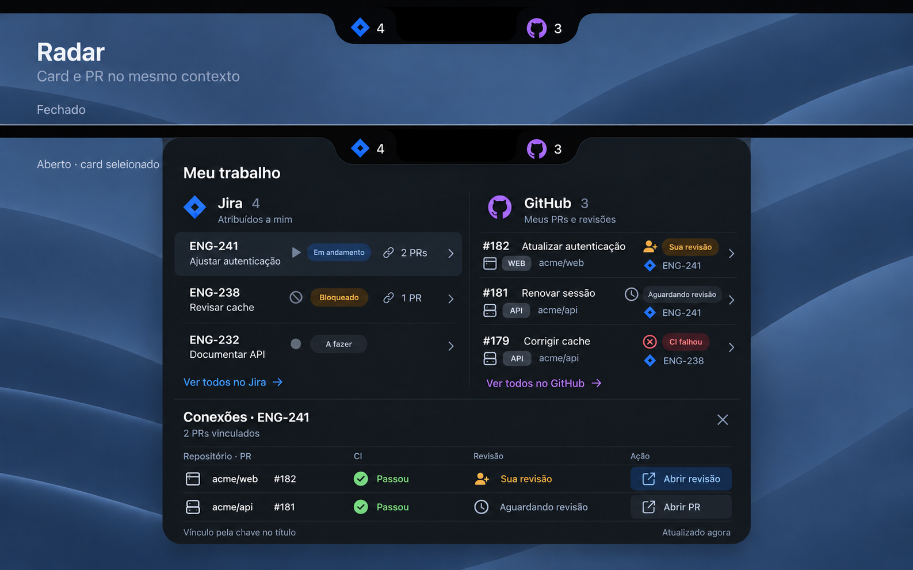

# Radar — V1 pessoal local

**26/10/2026 · GitHub conectado e consultado · V1 em qualificação parcial**

A V1 é pessoal: um app nativo para macOS 27 que reúne seus cards do Jira Cloud e PRs do GitHub.com. A revisão atual substitui gh por autorização no navegador e escolha de repositórios em uma lista com busca. O notch fica fechado com indicadores; um clique abre as duas colunas e a faixa inferior conecta tarefa e código.

A identidade visual canônica é a revisão 3: superfície preta, seleção cinza, símbolos/rótulos claros e nenhuma borda lateral colorida. As imagens estão incluídas neste pacote.

## Proposta técnica

| Parte | Proposta |
|---|---|
| App e painel | Swift + SwiftUI; AppKit restrito à janela, recorte, foco e displays. Target Xcode. |
| Jira Cloud | Token pessoal permitido pela conta, inserido diretamente no app e guardado no Keychain próprio. |
| GitHub.com | GitHub App próprio configurado, autorização no navegador e seleção de repos acessíveis; tokens no cofre próprio e consultas de trabalho REST GET. Fluxo autenticado em qualificação. |
| Dados | Conteúdo de trabalho em memória; preferências não secretas separadas das credenciais. |
| Relações | Chave Jira explícita em título/branch, com repo, site e proveniência; busca limitada aos repos selecionados. |
| Estados | Fase do PR, CI e revisão separados; total pessoal independente do número de vínculos. |
| Entrega | Bundle local pessoal, qualificado pelo Finder. Distribuição pública permanece fora do escopo. |

O target local usa Swift 6, SwiftUI/AppKit, assinatura ad-hoc e Hardened Runtime sem App Sandbox, conforme AD-010. O método Jira depende da política da conta e da entrada segura pelo usuário. Não foram instaladas ferramentas, publicadas versões ou alteradas configurações globais.

A revisão [GitHub nativo G1](.specs/features/radar/github-onboarding.md) conserva identidade no começo/fim dos lotes, contexto, cancelamento e limites. Autenticar não aplica repositórios antigos automaticamente: o usuário confirma as escolhas no catálogo da sessão atual. O cadastro único está descrito no [guia de ativação](docs/github-setup.md).

G02 está em `5aaf302`: autorização por código no navegador, sessão própria, renovação e catálogo com busca/seleção de 1–10 repositórios. Os builds Debug/Release finais e a revisão independente fresca passaram. A [qualificação G03](docs/evidence/G03.md) preserva o artefato histórico sem cadastro; o fluxo real posterior está em G05.

[G04](docs/evidence/G04.md) ativou o cadastro próprio privado e configurou somente Client ID/slug públicos, sem exigir cópia pelo usuário. Ele confirmou cadastro específico e instalação; Debug/Release, revisão estreita e UI com Conectar habilitado passaram. Em [G05](docs/evidence/G05.md), o usuário autorizou, o Radar carregou 68 repos e a busca local funcionou; a escolha explícita iniciou uma consulta recebida com 0 PRs pessoais no escopo. Renovação, retomada, remoção, PRs preenchidos, Jira e demais gates reais continuam pendentes.

## Sequência de implementação

| Lote | Tarefas | Entrega |
|---|---|---|
| 1. Base nativa | T01–T07 | Prontidão, target, recorte, painel, foco e animação. |
| 2. Domínio e estado | T08–T14 | IDs estáveis, contagem, snapshots, seleção e refresh limitado. |
| 3. Apresentação | T15–T21 | Indicadores, listas, faixa, configurações e teclado com a identidade aprovada. |
| 4. Integrações | T22–T28 | Baseline Jira pessoal e gh; parte gh substituída por G01–G03. |
| 5. Relações e recuperação | T29–T35 | Card ↔ PR, proteção contra respostas atrasadas, reconexão e ciclo de dados. |
| 6. Qualificação | T36–T42 | Integração final, destinos, displays, fluidez, acessibilidade e bundle pessoal. |

A baseline tem **42 tarefas**, **28 requisitos** e **56 critérios de aceite**. A revisão G01–G03 acrescenta 7 critérios específicos de onboarding e substitui os critérios de gh afetados. As fases não representam dias estimados. A prontidão foi qualificada em T01; cada entrega conserva seus gates e limites no manifesto.

## Como os subagentes trabalham

O Codex orquestra seis lotes sequenciais, com um único agente escrevendo código por vez. Especialistas de macOS e integrações podem pesquisar e conversar em paralelo. Todos usam o mesmo conjunto canônico de decisões/contratos, com mensagens explícitas e handoff por lote.

O verificador final recebe os documentos, a árvore de código e as evidências em contexto fresco. Nenhuma concordância entre agentes substitui observação no app. Não é necessário incorporar Codex/IA ao runtime do Radar.

## Índice do pacote

| Documento | Conteúdo |
|---|---|
| [Especificação](.specs/features/radar/spec.md) | Escopo, requisitos, critérios e suposições A01–A13. |
| [Contexto](.specs/features/radar/context.md) | Escolhas confirmadas e limites da autorização. |
| [Design técnico](.specs/features/radar/design.md) | Alternativas, componentes, contratos, auth, estados e riscos. |
| [Tarefas](.specs/features/radar/tasks.md) | 42 entregas atômicas, dependências, gates e commits propostos. |
| [Coordenação Codex](.specs/features/radar/coordination.md) | Contexto compartilhado, diálogo entre agentes, autoria e handoffs. |
| [Verificação](.specs/features/radar/verification-plan.md) | Roteiros manuais e evidência por critério, com limites claros. |
| [Pesquisa](.specs/features/radar/research.md) | Documentação Apple/Atlassian/GitHub/OpenAI e limites da evidência REA. |
| [Revisão independente](.specs/features/radar/plan-review.md) | Achados e resultado da revisão do plano. |
| [Conferência documental](.specs/features/radar/document-check.md) | Contagens, grafo, rastreabilidade e links locais conferidos. |
| [Estado e decisões](.specs/STATE.md) | Decisões ativas e próximo ponto de retomada. |
| [Roteiro visual](assets/fluxos-radar/roteiro-fluxos.md) | Oito pranchas/18 quadros de Jira e GitHub. |
| [Ajustes da identidade](references/radar-ajustes-visuais-v3.md) | Refinamentos visuais aprovados. |
| [Comportamentos anteriores](references/radar-conexoes-comportamentos-v2.md) | Origem dos fluxos aprofundados na especificação. |
| [Estudo inicial](references/estudo-notch-jira-github.md) | Pesquisa comparativa original. |

O roteiro visual antecede a autenticação atual: textos de conexão seguem Jira pessoal e GitHub nativo, preservando a identidade.

## Validação e limites

A regra do usuário impede criar testes, arquivos de teste ou mocks. O plano usa build, revisão de código, interação manual e medição, cada qual identificado. Automação/sensor de mutação ficam NOT-RUN por política; não haverá alegação de cobertura automatizada.

Os gates de uso real incluem recorte/foco, Jira e GitHub, relação bidirecional, teclado/VoiceOver/Reduzir Movimento, 30 ciclos de interação e lançamento pelo Finder. Condições externas não reproduzidas são registradas separadamente; revisão estática não comprova fluidez ou funcionamento no hardware.

A baseline anterior inclui integrações, relações, recuperação, persistência, ciclo de dados, navegação e display. Seus builds Debug/Release e revisões independentes passaram, incluindo correção C09 após a verificação final fresca. O Release foi aberto pelo caminho completo; gh 2.96.0 e persistência de preferências foram verificados pela UI sem consultar contas. Três ciclos CUA, duas leituras de repouso e comparação visual desconectada estão documentados. Isso não aceita a V1: fluxo central real, Keychain, VoiceOver/Reduzir Movimento e protocolo físico continuam pendentes. Os 56 critérios estão em [aceite](docs/evidence/acceptance.md) e o resultado em [revisão final](docs/evidence/final-verification.md); ver [gates pendentes](docs/evidence/pending-gates.md). Testes/mocks/sensores/Swift lint não rodaram; nenhum remote/publicação foi criado.

Para abrir o Release já gerado: [.build/DerivedData/Build/Products/Release/Radar.app](.build/DerivedData/Build/Products/Release/Radar.app). Metadados vigentes em [G03](docs/evidence/G03.md); o [bundle local](docs/evidence/local-bundle.md) preserva o histórico anterior. `./script/build_and_run.sh` continua gerando/abrindo Debug.

Ao iniciar, as contas ficam desconectadas. O GitHub próprio já está configurado no build pessoal: a UI conduz autorização e seleção de repositórios. Jira depende da política da organização e de entrada pessoal no SecureField; nunca envie token no chat. Retomar token salvo também é explícito. O app consulta apenas Jira Cloud/GitHub.com, mas as permissões existentes da credencial podem ser mais amplas.

## Execução local

Execute autorizado em AD-009. Este repositório é a fonte canônica; prontidão e limites estão em docs/readiness.md. Tarefas e evidências permanecem individuais, sem testes/mocks e sem publicação do app. AD-019 autoriza o espelho privado da fonte em [pedronazarito98/Radar](https://github.com/pedronazarito98/Radar), após revisão de segurança; entrega em [handoff GitHub](docs/handoffs/github-repository.md).

Os documentos em .specs deste repositório são a fonte canônica da execução. O pacote original permanece preservado como referência histórica. Os assets aprovados foram copiados; estado e handoff são atualizados aqui.

